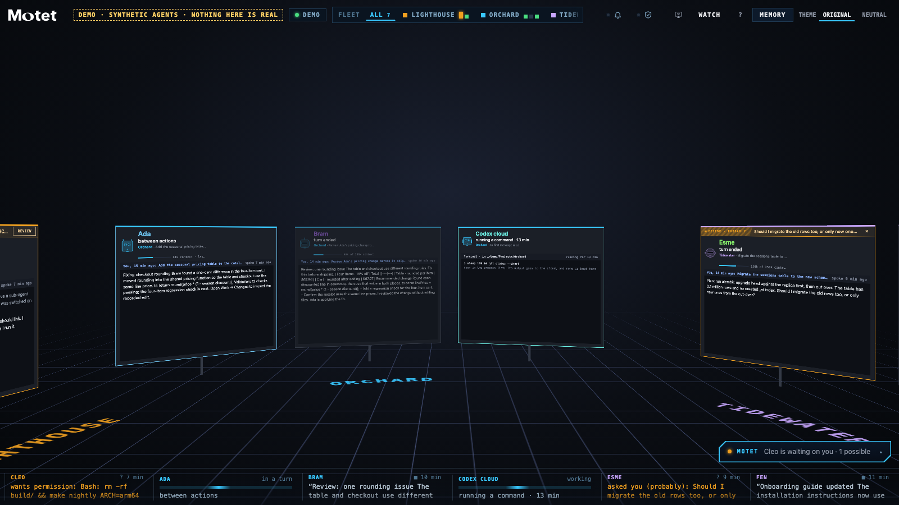
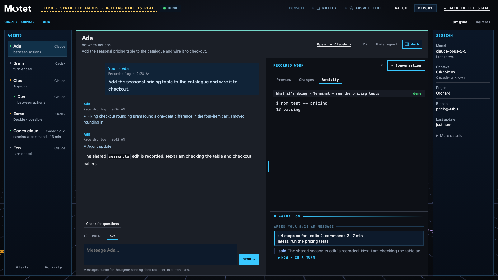
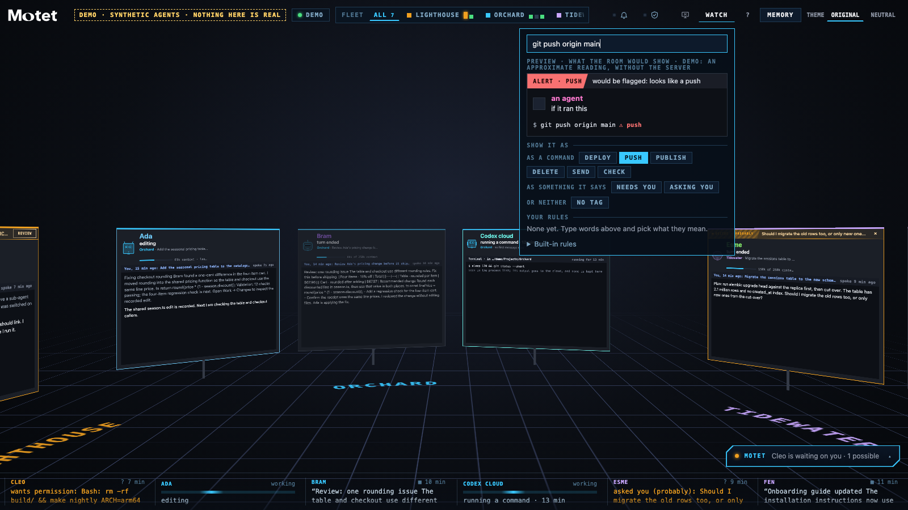
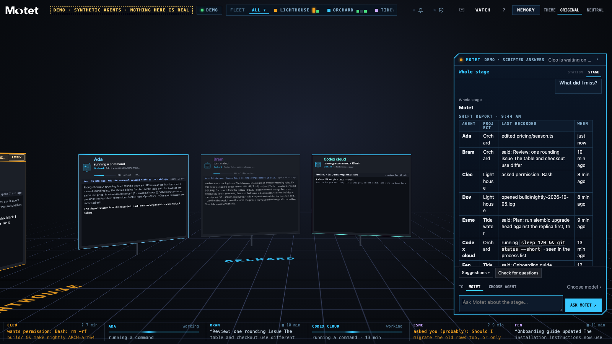
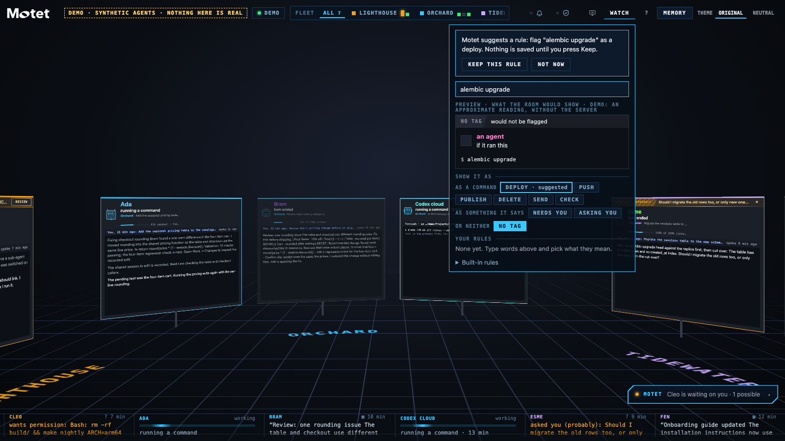

<p align="center">
  <picture>
    <source media="(prefers-color-scheme: dark)" srcset="docs/media/logo-green.svg">
    
  </picture>
</p>

<p align="center">
  <b>One workspace for your AI conversations—across Claude, Codex, Cursor, and more.</b><br> Follow conversations, inspect work, and use each provider’s supported capabilities from one place.
</p>

<p align="center">
  <a href="LICENSE"></a>    <a href="#status"></a>
</p>

<p align="center">
  <a href="#try-it">Try it</a> &middot; <a href="#what-you-can-see">What you can see</a> &middot; <a href="#what-you-cannot-see">What you cannot</a> &middot; <a href="#trust-boundary">Trust boundary</a> &middot; <a href="#status">Status</a> &middot; <a href="docs/ROADMAP.md">Roadmap</a> &middot; <a href="#license">License</a>
</p>

<p align="center">
  
</p>

> **Early.** macOS; on Windows only the automated tests have run, in CI. Python 3 standard library, no dependencies, one HTML page. Watching is safe to try today; read the [trust boundary](#trust-boundary) before switching on anything that answers prompts.

Current version is [v0.1.0](CHANGELOG.md).

The demos use fictional agents and projects. For public recordings, use `?demo` for Workspace or `?demo&ui=classic` for Classic. Live conversations and command output can contain personal information and absolute file paths.

## Why this exists

Your AI conversations live in separate tools. A discussion in Claude, a coding session in Codex, and a task in Cursor each have their own window, history, and controls. Returning to the right conversation means remembering where it lives, what you asked, and what happened since you last looked.

Motet brings supported sessions into one interface, with their conversations, recorded work, and available actions together. You can move between sessions without losing which provider or project they belong to. When a session has agents working beneath it, their relationships and activity stay visible too. Managing several running agents is one use of that workspace; returning to a conversation and understanding its context is another.

The **stage** gives you an overview of sessions and anything that may need your attention. Step up to a **desk** to read a conversation, inspect its work alongside it, and use the actions supported by that connection. Use **Ask Motet** to understand the recorded context and carry out explicit supported requests.

### What is supported today

The current release starts with locally recorded coding sessions: **Claude Code, Codex, Cursor, and Antigravity**. It follows recently active sessions by default, not every historical chat in your provider accounts. Codex cloud work running on this computer has limited command observation, without its conversation. Ordinary Claude web chats, ChatGPT chats, and other providers’ full account histories are not imported.

Reading a session does not mean Motet can send to it or control it. Eligible local Codex chats support queued messages and some active-turn controls. Existing Claude Code chats can receive owner messages through the optional [Motet plugin](#messaging-an-existing-claude-chat); permission answering uses separate optional hooks. The [capability table](#current-provider-capabilities) spells out the differences. Broader conversation coverage and provider actions are on the [roadmap](docs/ROADMAP.md), not implied by appearing on the stage.

## What you can see

For supported sessions, Motet brings together the available conversation and work evidence. These views come from session logs, optional hooks, app metadata, and records of your interactions through Motet. Rendered previews are read from disk when shown. Coverage varies by provider; each item is labelled by how it was learned.

- **The conversation and its work:** what it is saying, as the log records each message; the file it has open, edits shown as diffs, commands and their output; your messages to it; and a rendered preview of any HTML it writes. On the stage and in hand, a monitor shows the narration with your last message to that agent pinned above it in one line, so you know what you asked without stepping up.
- **What needs your attention:** permission prompts, questions, and plans to review, shown with the recorded text. Confirmed requests are distinguished from notices inferred from a message, which are labelled as possible.
- **Who is working**, with the step that is open, for as long as the turn runs.
- **Who stopped, and where:** an idle monitor carries a caption with the agent's last words, a failed last step, or the request it is waiting on.
- **The goal:** each monitor carries the first message of the session that was read, as a one-line reminder of what that agent is for.
- **Who started whom:** a chain of command, marked where it was recorded and where it was inferred. The desk's compact agent tree nests children beneath their parents and labels each agent's provider.
- **Which project:** the row is seated in bays by folder, with the project's name set into the floor, and you can give a folder a display name.
- **Alerts** when a command looks like a deploy, a push, a delete or a send, from a small shell-aware parser. The compact notice keeps the full command behind **View details**. **Dismiss alert** clears that event across the stage and desk for the current browser session; notices can reappear after a full reload. **Hide agent** is a separate action. The Watch button in the bar lets you add your own words to that list, or switch the built-in ones off.
- **Session facts:** model and known reasoning level, reported context usage, project, branch, and recent activity. Secondary recorded details sit behind **More details**. The context bar appears only when a capacity is recorded; a previous Claude compaction size is historical information, not a capacity.
- **Answers, when you ask:** Motet, available on the stage and in the selected station’s conversation, answers plain-English questions from the same logs: what you missed since some minutes ago, what an agent did, whether anything is stuck, who is waiting on you, who changed a file. It keeps each record's own qualifications ("started", "tried to", "probably", "outcome not recorded"), shows the entries it consulted, and can draft a Watch rule for you to keep with one button. It needs an Anthropic API key on this machine; without one it stays off and says why.

In Classic, the desk puts one conversation in the monitor, with compact agent navigation on the left and recorded session facts on the right. Choose the agent to send a message when that connection supports it, or Ask Motet about the station or stage. **Work** slides open beside the conversation: **Preview** shows recorded visual evidence, **Changes** shows recorded edits, and **Activity** combines the current step with the full activity log. Drag the divider, or use its arrow keys, to adjust the work area. Preview may read the current file from disk; Changes is log evidence, not a Git working-tree diff.

Agent responses support formatted text, including headings, lists, tables, links and code blocks. The composer stays plain text: Enter sends, and Shift+Enter adds a line. The agent list scrolls independently of the **Alerts** and **Activity** controls at its foot.

On narrow screens, **Agents** and **Details** open as drawers and Work temporarily replaces the conversation; **← Conversation** returns to your messages. A pending permission has a **Review** action even while Work is closed; Review only reveals the request. Original remains the default theme; Neutral offers a light palette without changing message routing or recorded facts. Choose a theme on the stage's top bar, beside **Chain of command** at a wide desk, or in the desk toolbar on a narrow screen. The choice is remembered in that browser.

<a id="workspace-interface-preview"></a>

### Workspace interface

The [plain address](http://127.0.0.1:8793/) opens Workspace on desktop and phone. Use [`?demo`](http://127.0.0.1:8793/?demo) for the Workspace demo. The previous interface is available at [`?ui=classic`](http://127.0.0.1:8793/?ui=classic), with its demo at [`?demo&ui=classic`](http://127.0.0.1:8793/?demo&ui=classic). Unlock keeps the current interface, and the choice lives in the address. Existing `?ui=workspace` links still open Workspace. Workspace opens in the light theme. Theme selections made there are temporary and leave the saved Classic theme preference intact.

Workspace brings the stage sidebar, notification bell, monitor contents, conversation desks and Settings into one light interface. Stage movement and interactions stay the same. The bottom caption strip is omitted; each agent’s sidebar tooltip carries its caption and recorded or inferred qualifications. Opening the notification bell shows existing requests and recorded alerts. The **Notify me** control remains separate in Settings.

<p align="center"></p>
<p align="center"><sub><b>An agent's desk in Workspace.</b> The conversation on the left, recorded changes on the right. Fictional demo data.</sub></p>

Choose **Motet** in the sidebar for its desk. **Recorded days · UTC** opens retained Motet questions and answers when memory recording has captured them. Saved days are read-only: browsing them makes no model call and cannot retry, apply or send anything. Coverage can be partial, not recorded, expired or unavailable. Return to the current window to continue your conversation; its draft stays in place.

<p align="center"></p>
<p align="center"><sub><b>Motet's desk.</b> Ask about the stage and read the answer with the recorded evidence behind it. In the demo the answers are scripted and say so.</sub></p>

See [brand assets](brand/README.md) for the Motet wordmark and icon. Workspace follows the same provider and permission limits described below.

The sidebar names the app each agent runs in (Claude, Codex, Antigravity or Cursor) as text after its name. To show icons instead, put your own files in `~/.live-room/app-icons/`, named `claude`, `codex`, `antigravity` or `cursor` with `.svg` or `.png` (up to 256 KB each, a plain file, not a link), then reload the page. Motet ships without provider icons and the demo always shows text; you are responsible for having the rights to any icons you add. Icons are not offered on Windows yet.

**Motet file reading** ships enabled and requires the host’s private spending policy and an Anthropic API key. Once set up, you can keep a PDF or PNG in a Motet conversation without asking a question, then choose **Use in next question** in **Files**. Each file question sends only the files in its tray. Auto uses Haiku 5.5 for file questions and the answer identifies the actual model; other explicitly selected models are refused. File citations open explanatory metadata, without drawing or downloading the original.

File cards distinguish Motet's kept copy, files supplied for a particular answer, and that answer's cited sources. A valid answer without text is identified explicitly, with its citations still available.

The Files view can remove Motet's retained original, with explicit confirmation and status recovery. This does not remove the original you selected, a provider's copy, or your messages. Dependent answers stop being shown; uncertain cleanup is not reported as success. Local file management can remain available while file reading is off. See [Set up Motet file reading](docs/MOTET_FILE_READING.md) for the local policy, supported formats and usage limits.

**Files to agents** ships enabled for eligible local Codex and plugin-connected Claude chats. Sending files to agents needs SQLite 3.45 or newer in the Python that runs Motet. If that Python has an older database library, Motet explains that file sending is unavailable while ordinary messaging remains available. Attach a PDF, PNG or JPEG in the agent's workspace composer. The draft is kept locally. Send saves copies to the verified project folder and queues the message with references to those files. Motet reports unconfirmed delivery as uncertain. The destination must be an eligible local parent chat in a regular Git checkout. Codex also requires macOS desktop version `26.1029.61003`, build `24614`, and a chat with GPT-6 Astra and compatible settings. A Claude chat needs a live attachment-capable Motet plugin connection. Claude sessions run by Motet do not qualify for this relay. The demo uses fictional files and never sends them.

**New chat** ships enabled in the workspace on macOS. Choose a verified folder from the workspace's project list. On Codex Desktop version `26.1029.61003`, build `24614`, open a blank chat or use **Start working** with an instruction when that mode qualifies. **Claude run by Motet** launches local Claude Code with an instruction. Motet checks Claude Code `2.1.323` against a pinned executable hash and requires a verified readiness record for that Mac and user at `~/.live-room/managed-claude-readiness.json`. This release has no self-serve setup for that record. Blank managed Claude chats are unavailable. Motet shows the session on the stage only after it verifies it belongs to the selected folder. If a provider, app build, host or folder cannot be verified, the corresponding action stays unavailable.

### Current provider capabilities

Codex messaging, controls and native reads require macOS and an eligible local connection. Steering, interruption and native reads require Codex Desktop `26.1016.62342`, build `21477`. New chat and sending files to Codex require `26.1029.61003`, build `24614`. With one desktop build installed, only its group is available. Motet verifies the installed app files as well as the version and build. Claude permissions have separate paths for optional hooks and chats started by Motet.

| Capability | Local Codex | Claude Code | Cursor | Codex cloud on this computer | Antigravity |
| --- | --- | --- | --- | --- | --- |
| Observe recorded activity | Session logs | Session logs; optional hooks | Transcript; tool results not recorded | Commands from the process list | Native transcript; uncorrelated tool outcomes |
| Open the existing chat in its app | Supported local desktop route | Supported local desktop route | Unavailable | Unavailable | Optional Motet Navigation connector; macOS, verified app version |
| Send a direct message | Queue to an eligible existing chat | Queue to a connected existing chat through the optional Motet plugin | Unavailable | Unavailable | Unavailable |
| Receive agent-to-agent messages | Reachable chats through the shared MCP | Compatible Motet plugin with agent messaging authorized | Unavailable | Unavailable | Unavailable |
| Steer or stop the active turn through Motet | Supported when the control checks pass | Unavailable | Unavailable | Unavailable | Unavailable |
| Promote an already queued message with Steer | Unavailable | Unavailable | Unavailable | Unavailable | Unavailable |
| Read native questions | Supported, read-only, on the verified build | Unavailable | Unavailable | Unavailable | Unavailable |
| Answer permission prompts in Motet | Unavailable | Optional permission hooks with **Answer here** enabled, or the permission flow in a chat started by Motet | Unavailable | Unavailable | Unavailable |

You can still open an unsupported desk, inspect the evidence available there, and ask Motet about it when the assistant is configured. Direct **Send** stays disabled with an explanation. Use the original app for unsupported actions; **Open in…** works only where Motet has a supported route.

### Antigravity desks and monitors

Recently active local Antigravity conversations appear automatically, using the same desks and monitors as the other apps. No Motet plugin, MCP configuration, hook or per-chat enrollment is needed for observation. Motet follows native transcripts under `~/.gemini/{antigravity,antigravity-cli,antigravity-ide}/brain/<chat-id>/.system_generated/logs/transcript.jsonl`. The desktop app format has been verified locally; CLI and IDE sources use the same adapter when their records match that format.

Chat names, project folders, explicit parent relationships and activity state come from a bounded read-only query of the source's optional `conversation_summaries.db`. Missing, busy or incompatible metadata leaves a generic name and unknown facts without stopping transcript observation. Duplicate native chat IDs across source roots are excluded rather than merged. Provider-added prompt metadata and settings are removed from native user messages. Tool requests are visible, but their outcomes remain unknown because these transcripts do not correlate tool calls with results. A step marked DONE is not treated as a finished turn. Context usage and the selected model remain unknown when the native records do not establish them.

Motet can read these observations and, when memory is enabled, retain new activity under the same privacy and retention rules as other local logs. Antigravity's private storage is excluded from file previews. Messaging, cross-provider delivery, steering and permission answering are not connected; use Antigravity itself for those actions.

#### Open an existing Antigravity chat

On **macOS with Antigravity 2.31.2**, open an Antigravity desk in Motet and choose **Connection → Install connector**. This installs **Motet Navigation** once for your user account and authorizes opening existing desktop chats. In Antigravity's **Customizations → Installed**, enable **Motet Navigation** once, then open **Extensions → Motet Navigation** in any existing chat. There is no per-chat installation, pairing code or target list. Motet does not rewrite Antigravity's settings file.

Motet displays **Open in Antigravity** only while the native panel has a live connection and the exact desktop chat can be verified. You can hide the panel after it connects. If the connection ends, reopen that panel and refresh Connection in Motet. Installation alone does not guarantee a connection after startup or after the app unloads a panel. CLI, IDE, ambiguous identities, other app versions and other platforms remain unavailable for opening; observation continues separately.

Opening requests navigation to the existing chat and brings the verified running app forward. It sends no message, starts no model turn and creates no chat. **Opening requested** reports dispatch, not independent confirmation of the selected chat. An uncertain request is never retried automatically.

Choose **Connection → Disconnect** to revoke further navigation. This leaves the native extension installed and its native toggle unchanged; **Enable connection** in Motet restores authorization. A navigation request already issued cannot be recalled. To remove the installation, first turn the Navigation extension off in Antigravity's Installed list, wait for it to stop, then run `python3 scripts/install_antigravity_open.py remove` from this repository. Updates to connector files also require turning it off first. The same script supports `install`, `status` and `disconnect`. Unrelated native settings are preserved. Private authorization and connection files stay under `~/.live-room/antigravity-open/`; credentials are excluded from public status, events and Motet context. See the [connector notes](integrations/antigravity-open/README.md) for its protections and limits.

### Where support goes next

The next priorities are easier discovery and return to supported sessions, reliable messaging and steering across providers, and a clearer view of what each connection can do. Claude live controls and promoting a queued message with **Steer** need verified delivery routes before they can be enabled. Cursor actions and additional providers remain exploratory. Optional [Motet memory](#motet-memory) retains searchable history while Motet runs. Broader launch support, full-account imports and coordination across sessions are future work. See the [roadmap](docs/ROADMAP.md#priorities) for scope and completion criteria.

## What you cannot see

The stage shows what those records contain and nothing else. That rules some things out, and the page says so rather than guessing.

- **Not the agent's reasoning.** Hidden thinking is not in the logs, so it is never shown or paraphrased.
- **Not keystrokes.** Granularity is a tool call, a result, a message, a turn boundary. A step in flight is shown as open, not as a progress bar.
- **Not "idle".** "No log entry for N" means the log is silent. Silence is not proof of anything.
- **Not "done".** A command whose exit code is not recorded is shown as *returned*, not done.
- **Not certainty about parents.** "Started by" is *recorded* when the log says so and *inferred* when it was worked out from a launch command, and the label says which. A guess from script text is shown as "possibly started by" and is never stored.
- **Not Codex's private channels.** Encrypted messages between agents cannot be read from its log. The separate native observation panel can show supported questions on a verified desktop build; it does not expose approval details or the native message queue.
- **Not Cursor's results.** Cursor's transcript records what a tool was asked to do, not what came back, so a Cursor step is shown as *returned* when its turn ends, never as done.
- **Not the future.** "Probably needs you" notices read the agent's last sentences and can be wrong either way.
- **Not a cloud agent's words.** A Codex cloud agent that works on this computer does it through the ChatGPT app's exec server, one command at a time, and keeps no transcript here. Its monitor is read from the process list instead: the commands as they run, with their folders, and nothing else. Its conversation, Preview and Changes views say that its words, what it reads and what it changes are not recorded on this computer; the list is sampled about once a second (longer while a folder is being looked up), so a shorter command can be missed, and of several new commands at once the oldest four are examined first and the rest the next sample, so a short-lived one among them can be missed; a finished command is *ended*, never done; "exec server running" never means working, because the server stays up while the agent is idle; and when the list cannot be read the monitor says so and drops any running claim. The list is text: a process is recognised as an exec server by the text of its command, not by proof of what program it is, and a process is told from another by its pid and start time to within a few seconds.

## Try it

Two minutes, no install.

```bash
git clone https://github.com/glo6al/motet.git && cd motet
python3 src/server.py
```

On Windows, use `py src/server.py` (or `python`) instead of `python3`. [docs/WINDOWS.md](docs/WINDOWS.md) walks through installing Python and Git and trying it, step by step; see [Windows](#windows) for what differs.

Then open <http://127.0.0.1:8793/> for Workspace and press **Unlock**. The server asks your default browser to open a new, unlocked tab, and the stage fills with whatever Claude Code, Codex, Cursor or Antigravity sessions have been active in the last twenty minutes (`WINDOW_MIN` to change that, `PORT` to move it).

**No sessions of your own?** Open <http://127.0.0.1:8793/?demo>. A synthetic fleet plays through a sample of what the stage can show: working, waiting on you, a question, a hand-off, a sub-agent, last words. Open <http://127.0.0.1:8793/?demo&ui=classic> to follow the Classic walkthrough below. One agent holds a permission request you can answer on the page: click its APPROVE tag, then Allow or Deny, and a scripted outcome follows; nothing is sent anywhere, and the switches in the bar work on the page only. For a recording, open Bram’s desk to show a formatted review with a comparison table and code, then Ada’s **Work → Changes** for the recorded pricing edit. Cleo and Dov demonstrate the parent–child tree; Cleo also has the simulated permission prompt. Reload `?demo` to restart the sample story. There is no rendered preview and no summarisation marker. Direct messages and Motet answers in the demo are also scripted; they do not contact agents or a model. The demo page reads no logs and needs no key, and the bar says so. The server behind it is the ordinary one: it still creates its key and follows your real logs in the background, because it is the same process; after loading its page and icons, the demo makes no live-data or action requests to it, and it keeps its own project names rather than this browser's.

**Optional hooks** (Claude Code on macOS only). In a second terminal, while the server is running:

```bash
python3 scripts/install_hooks.py            # --remove to undo
```

If you moved the server with `PORT`, run the installer with the same `PORT` and open the page on that port. The server, the hooks and the browser must all agree on it.

This adds Notification, Stop, SubagentStop and PermissionRequest hooks to your Claude Code settings. The first three only tell Motet things sooner than the log would. The fourth lets Motet answer permission prompts for you, and is off until you switch it on in a window. Read the [trust boundary](#trust-boundary) first.

**Moving around:** two-finger scroll or drag to turn, or the arrow keys. Hover a monitor and it comes to your hand; click it to step up to its desk. The conversation is the main view. Open **Work** for **Preview**, **Changes** or **Activity**; when focus is outside the conversation and text fields, keys **1**, **2** and **3** open Activity, Preview and Changes respectively. Drag the Work divider or focus it and use the arrow keys to resize; double-click it to reset. **← Conversation** closes Work. Use **Back to the stage** to leave the desk; Escape first closes an active picker or drawer or handles conversation focus before leaving the desk.

**In a terminal instead.** With the server running, in another terminal:

```bash
python3 src/watch_tty.py            # a board: one row per agent, those waiting on you first
python3 src/watch_tty.py --tail     # one line per event, to read or grep
python3 src/watch_tty.py --once     # one line such as "2 waiting · 3 working", for a tmux or prompt status bar
python3 src/watch_tty.py --tab      # iTerm2: the board in a new window, then one tab per agent, each with its own log
python3 src/watch_tty.py --split    # iTerm2: the same in one tab, the board on top and each agent in a pane below
```

The board and the tail ring the terminal bell when an agent starts waiting on you. In iTerm2 an agent's tab or pane is titled with its name and project and turns amber while it waits on you, and the board's tab shows a "2 waiting" badge. The board opens a tab for each agent active in the server's window, and for each new one as it appears, without taking the focus; a view you close stays closed. Panes halve the largest one as agents arrive, and a tab too small to split again gets a new tab. Each view is one of the twelve connections the server allows, browser windows included, so the board opens at most six and says how many it left out; a view the server turns away waits for a free connection for up to a minute. Run one board at a time: a second one can take the connections your browser window needs. `--tab` copies `src/iterm-profile.json` to `~/Library/Application Support/iTerm2/DynamicProfiles/project-watch.json`, replacing any earlier copy, and the first time, macOS asks whether your terminal may control iTerm2. The terminal reads the same stream as the page, with the same key, and it only watches: it cannot answer a prompt. Use the same `PORT` as the server.

<a id="the-room-and-the-desk"></a>

## The stage and the desk

These pictures are from the [Classic demo](http://127.0.0.1:8793/?demo&ui=classic), which uses fictional agents and projects. Open it to explore the same examples.

<p align="center"></p>
<p align="center"><sub><b>The stage.</b> One monitor per agent, seated by project. The ledge along the bottom says where each idle agent stopped and shows a sweeping rail for each one that is working.</sub></p>

<p align="center"></p>
<p align="center"><sub><b>In hand.</b> Hover and the monitor comes to you and stays put while you turn the camera, showing what the agent is saying under your last message to it. The banner across its top is the permission request it is waiting on; click its tag to open it at the desk.</sub></p>

<p align="center"></p>
<p align="center"><sub><b>The desk.</b> Read the conversation and inspect recorded work alongside it. Work offers Preview, Changes and Activity; its divider adjusts the space. The agent tree preserves parent–child relationships, while session details stay in the right rail.</sub></p>

<p align="center"></p>
<p align="center"><sub><b>Watch.</b> Type a command or a sentence and the panel draws the banner the stage would give it. If that is wrong, click what it should be and the stage learns those words. Your rules are listed below; the built-in ones are folded under them, each with a switch.</sub></p>

<p align="center"></p>
<p align="center"><sub><b>Motet.</b> The plate on the bottom band carries the stage's own count of who is waiting on you; press it, or <code>/</code>, and it opens as this panel. Ask about the stage in plain English. The answer comes from the logs the stage keeps, laid out like a README when that reads better, with the entries it consulted as chips that jump to them. Outside the demo, the server asks the model; in the demo the answers are scripted from the synthetic agents and say so.</sub></p>

<p align="center"></p>
<p align="center"><sub><b>A rule it drafted.</b> Ask Motet to flag something and it drafts the words and the kind into the Watch panel, with the stage's preview and two plain buttons, Keep this rule and Not now. Nothing is saved until you press Keep this rule; Motet cannot press it, and no answer can write a rule on its own.</sub></p>

## How it works

- **A log appears on the stage** when its file changed within the window and, for Claude Code, Codex and Antigravity logs, the last record that states a time is within the window by the log's own clock, so touching a file whose last timed record is outside the window does not bring it in. Only a record's own timestamp counts, never one quoted inside it; a log whose last timed record cannot be found is not admitted until one is written; Cursor's transcripts state no time and are judged by the file alone; a pinned log is followed regardless.
- **The server** (`src/server.py` and its provider adapters, standard library only) follows `~/.claude/projects/**.jsonl`, `~/.codex/sessions/**.jsonl` and `~/.cursor/projects/*/agent-transcripts/*/*.jsonl`, turns each record into an event, and streams events to the page over server-sent events on 127.0.0.1. A Cursor transcript records the request to run a tool, not the tool's result, so those steps are shown as returned when the turn ends, not as done. It records no link that opens the chat. Antigravity native JSONL and optional read-only SQLite metadata also feed the same event stream; see [Antigravity desks and monitors](#antigravity-desks-and-monitors) for coverage. Local observation runs without an external service. Optional Motet requests use the Anthropic API, and supported actions use their provider adapters; see the trust boundary below. Rendered previews are the one place agent-written code runs; the trust boundary below says what they can and cannot reach.
- **The page** (`src/web/index.html`, one file, no build step) draws the stage with CSS 3D transforms. The camera stands where it would for five monitors and never backs away, so the monitors in front of you stay readable however many agents there are; the rest of the row curves out of frame and you turn to it. The fleet strip at the top is the map: one chip per project, one lit cell per agent.
- **The hooks** (`scripts/install_hooks.py`) are small shell commands Claude Code runs at Notification, Stop, SubagentStop and PermissionRequest. They post to the server with the key from a private header file.
- **Codex cloud agents** are found in the process list (macOS and Linux; `ps` about once a second on its own thread, and `lsof` once per new command for its folder). The list names every process; only this user's are considered, and only an exec server recognised by the text of its executable and subcommand, and its direct children, are kept: their pid, start time, command line and working folder. A folder name lsof had to escape is not trusted and shows as not readable. OpenAI marks that server experimental, so this can change under us.
- **Motet** appears on the stage as a plate on the bottom band (lamp, name, and the stage's own count of confirmed requests waiting on you, with requests the log only suggests counted separately as possible) that opens upward (click it, or press `/`) into a panel where you ask about the stage in plain English: what you missed, what an agent is doing, whether anything is stuck, who changed a file. Three one-tap chips carry the questions you ask most ("What did I miss?", "Anything stuck?", "Who is waiting on me?"). The server answers through the Anthropic API (automatic Haiku Q&A and Sonnet summaries; no routing-mode setup is required) with read-only tools over what the stage already holds (the agents, a bounded timeline each, everything since some minutes ago, a search across kept steps, whether a desk can be opened), keeping each record's own qualifications (a guessed command stays "probably", a failed change "tried to", an inferred parent "inferred"), and the panel shows the log entries it consulted as chips that jump to them (or say the entry is no longer on the desk). It can use the stage controls on your screen (filter, go to a desk, dismiss, draft a text for your clipboard, draft a Watch rule into the Watch panel, where only your press on Keep this rule saves it) and relay an explicitly requested message to a local Codex conversation. A separate interpreter sees only your latest request, not logs or earlier replies; the normal log-reading tools cannot send, approve or pin anything. The target, complete question and delivery status appear in the panel. It is off, and says why, unless an API key sits in `~/.live-room/anthropic-key` as a plain file only you can read, no key-shaped string sits anywhere in the project tree, and every file there could be read. Not offered on Windows yet.
- **Motet model:** ask normally; Motet chooses its model automatically, with no routing-mode click or setup. It uses Haiku for ordinary Q&A and Sonnet for summaries and handovers, according to `motet/MODEL_POLICY.md`. The existing intent check uses Haiku and classifies only your latest request; logs and skill cards cannot select a model. The answer keeps one model through all its tool rounds. Alternatively, choose any concrete model returned by your configured Anthropic API account to use that model for both the intent check and answer. Your selection is saved privately in `~/.live-room/officer-model.json`; older saved model choices automatically adopt routing when the updated server starts, without rewriting the private settings file. Only a new explicit manual choice overrides routing. The selector shows **Auto** during automatic routing and the selected model name for a manual override. A question already running keeps its original plan. A missing policy or unavailable required model prevents automatic routing rather than silently substituting another model. This changes only Motet. Use the single agent chooser on the left to select a message recipient.
- **At a station**, the conversation panel shows recorded agent messages, queue observations and direct-message delivery records in the agent lane, and Motet answers in its own lane. The composer explicitly selects the agent or Motet; changing recipient or scope does not send anything. Each address keeps its own draft, and submitted messages keep their original target even if you change stations. Press `/` to ask Motet. Recorded evidence opens in the work area, and citations reveal their exact conversation or activity entry. Pending answers do not move you unexpectedly: suggested screen changes wait for your click when you have navigated away.
- **Everything in a log is treated as untrusted.** An agent can write anything into its own transcript. Counts are validated and text is escaped before it reaches the page, and the page's script runs under a per-request nonce so that nothing arriving as data can run even where an escape is missed.
- **Faces:** each monitor's avatar is a machine head drawn from the session id, so an agent looks the same every day. Its visor light only repeats what the monitor border says: scanning while a step is open, steady while the agent waits on you, dim between steps, dark when the log is silent. It has no expressions, because the logs record none.
- **Project names:** a folder can be shown under another name by listing it in `~/.live-room/projects.json` as `{"folder name": "shown as"}`, read when a window connects. Double-clicking a chip sets a name for that browser only. Neither is in the public files.
- **What counts as a risk, a check, or "probably needs you"** is the Watch button in the bar. Type a command or a sentence and the panel draws the banner the stage would give it; if that is wrong, click what it should be and the stage learns those words (`make release` as a deploy, `want me to commit` as asking you). Your rules are listed as sentences with a remove; the built-in rules are folded below, each with a switch and a sample of what it watches. The words are kept in `~/.live-room/watch.json`; the shipped patterns stay in `src/watch.json`. Who started whom is not in either file.
- **Links between agents**, once made, are kept in `~/.live-room/links.json` (agent ids, the parent, a one-line reason, and whether it was recorded or inferred; never prompt text or folders) and restored at start-up. A recorded link replaces an inferred one; an inferred one never replaces anything; a stored link is dropped after thirty days without the child being seen. "Unlink" at the desk drops a stored inferred link.

### Motet instructions and skills

Motet's voice and working methods live in [`motet/INSTRUCTIONS.md`](motet/INSTRUCTIONS.md), [`motet/VOCABULARY.md`](motet/VOCABULARY.md), and five cards under [`motet/skills/`](motet/skills/): shift reports, stuck-agent checks, conflict checks, handovers, and Watch-rule drafts. Ask normally; Motet selects a card when useful. Each question snapshots the instructions and available cards, so an edit applies to the next question without changing one already running.

Only a short skill menu is sent initially. The read-only `load_skill` tool returns a selected card; it adds no stage actions or authority. Loading a card uses the existing request allowance and may add an API round. Tools, permission boundaries, redaction, dispatch, and request limits remain in Python. Missing or invalid core files use the complete built-in instructions; an unavailable card is omitted. A new skill file alone cannot add a tool or enable messaging.

The golden questions in `tests/fixtures/officer/golden_questions.json` use the existing fictional demo fleet. Run `python tests/test_officer_evals.py` for offline evidence checks. These do not prove model behavior, and the browser's demo answers remain scripted. The optional `scripts/eval_officer.py` runner lists cases without making requests; its explicit live mode uses the configured Motet API key and bills that API account. It tests fictional evidence only, without changing the saved model or sending agent messages.

### Motet evidence and follow-ups

Motet has shared read capabilities for discovering live and retained chats, searching or browsing a chosen period, counting matching saved observations, selecting an overview across chats and time, and expanding nearby discussion or linked operation results. These are reusable tools, rather than a fixed list of supported questions. No new service, embeddings, background model summaries or historical import is required.

Saved-event totals cover the full matching retained population when the source can establish it. Selected excerpts are identified separately. Live and retained counts stay separate unless provenance establishes that observations are the same. A successful operation is not proof of a completed goal, and recording gaps do not prove inactivity. Typed count fragments bind their source, unit, scope, period and completeness; reference checks do not certify the meaning of the surrounding model-written explanation.

After shared evidence reads, final answers use [Anthropic's structured output format](https://platform.claude.com/docs/en/build-with-claude/structured-outputs) or the equivalent answer tool. Python then checks the supplied references and exact typed assertions before rendering the answer. Calendar dates and recent intervals are normalized locally, including daylight-saving boundaries; the model does not have to calculate Unix timestamps.

Run `python scripts/eval_officer_capabilities.py` to list the fictional broad-summary, count and follow-up cases without reading a key or making a model call. Its explicit live mode records private reports for human review. The [capability design and verification](docs/MOTET_CAPABILITIES.md) describe the tests and their limits.

Source references accompany the current day's Motet conversation in this browser. The server signs the answer and its evidence metadata, then revalidates sources before later use. Edited, unsigned, expired or erased assistant text is excluded from future model replay; owner-written questions remain. Sources open in the existing memory viewer. Restarting Motet invalidates the old process's receipts, so Motet must query evidence again. Optional durable Motet history now retains sanitized questions and answers under the same memory controls; see [the backend contract](docs/MOTET_HISTORY.md). Process-bound receipts are never restored as action authority.

Answers stay readable when observations change or source verification is temporarily unavailable, with a visible explanation of the uncertainty. Opening Memory or a source does not invalidate an answer. When saved input was actually deleted or expired, Motet replaces the affected model-written summary with freshly checked, attributed excerpts from surviving records; it omits earlier derived totals rather than guessing. This does not make another paid model call. Source links check the requested record independently.

Publication and deletion are ordered at a short server-side gate. A deletion committed first requires preparation from surviving records; a publication committed first is already published. The browser checks for later committed erasure independently of drawer navigation. Text already published may arrive later over the network; Motet cannot make browser display atomic with deletion or retract data already sent to a model.

Each request has one allowance covering intent checking and all answer rounds: at most seven model attempts, two minutes, 512 KiB of cumulative request input, 12,288 reserved output tokens, 64 KiB of supplied evidence and bounded local query work. Measured usage can reconcile a reservation; an unknown or unfinished attempt keeps its reservation. Summaries have a larger per-answer output allowance than quick questions. Reaching a limit produces a partial-result notice, rather than silently dropping agents and claiming a complete report.

The default policy uses these non-monetary limits and does not promise a dollar ceiling. `OFFICER_REQUEST_USD` explicitly selects strict estimated-dollar admission. A strict request cannot make a paid call without applicable dated rates and a validated request-specific input-token bound. The standard transport currently supplies no such bound, so strict mode refuses calls rather than guessing a price, changing models or silently reverting to the default policy. The usage ledger below still records actual attempts and available estimates.

### Motet usage and cost

Ask Motet how much it has used or spent. Motet records its own API attempts locally in `~/.live-room/officer-usage.sqlite3`, including the intent check and each answer round. It retains ninety days of model names, token counters, request stage and completion status, within a bounded store. It does not save prompts, answers, project names, file paths, credentials or provider response bodies in this ledger. This accounting is separate from Motet memory and begins with the updated server; it does not reconstruct past bills.

Token counts come from API responses. Dollar amounts are **estimates**, using dated public rates in `motet/PRICING.json`, rather than a bill or account balance. Unsupported pricing, missing usage, timeouts, or incomplete tracking remain unknown; they are never counted as free. The estimate covers recognized standard global requests only, without account-specific discounts, credits or taxes. Set `OFFICER_USAGE=0` when launching Motet to stop recording new usage. Use `python scripts/officer_usage.py --help` for local inspection and deletion. Fleet-wide agent costs remain a longer-term item: a context-window counter alone cannot establish spend.

### Anthropic-reported usage and cost

Optionally connect an Anthropic Console Admin API key to ask Motet about actual organization usage and costs. Save the key separately in `~/.live-room/anthropic-admin-key`, in the private state directory, as an owner-only regular file (`chmod 600` on macOS/Linux). Keep the normal model key in `~/.live-room/anthropic-key`. Admin keys have broad provider permissions; Motet uses this credential only for fixed, read-only reporting requests. Never put either key in the repository or a conversation. [Anthropic's Admin key setup](https://platform.claude.com/docs/en/manage-claude/admin-api-keys) explains creation and expiration.

Ask naturally: **“What is my actual Anthropic token usage and cost this month, broken down by model?”** Other examples are **“Show yesterday's reported usage”** and **“Compare reported token use and cost for the last seven days.”** Calendar ranges cover at most 31 days; requested local dates and the actual UTC-hour reporting bounds are returned separately. This connection follows Motet's existing platform restrictions.

These reports cover the Anthropic organization accessible to that key, including usage outside Motet. They are separate from the estimates for Motet’s own model calls and cannot identify a particular Motet agent's costs. Reported cost is in USD after discounts and before credits; it is not an invoice, prepaid balance, subscription allowance or remaining spending budget. Motet does not read or change spending limits through this connection. [Anthropic's reporting documentation](https://platform.claude.com/docs/en/manage-claude/usage-cost-analytics-api) describes coverage: data can lag by up to 24 hours and is subject to later reconciliation. Motet receives each report's refresh time; missing or incomplete results remain unknown rather than zero.

Only validated numerical aggregates, dates, fixed qualifications and optional public model labels reach Motet. The admin key, raw provider bodies, account identities, actor names, workspace and API-key identifiers, pagination tokens and provider error text are excluded. Reporting creates no raw-report database, cache or background polling, and grants no new peer messaging or account-management capability. Existing Motet conversation history can retain the aggregate answers under its normal retention rules. Removing the optional credential stops subsequent reporting requests without affecting the model key.

### Motet memory

Talk to Motet as usual: **“What did Atlas do yesterday?”** Motet can search its retained memory, explain gaps, and show the saved sources behind its answer, including activity from chats no longer on the stage. You do not need to browse an archive or select a history tool first. Motet uses the host’s local calendar dates to interpret words such as “yesterday.”

Open **Memory** in the toolbar to enable recording. Recording starts **off**, with a **30-day** default retention adjustable from 1 to 365 days. The small settings panel also lets you pause recording, exclude chats or projects, and delete saved activity by chat, project, or all memory. Pausing or turning recording off keeps earlier retained activity available to Motet. A source button beside an answer opens that saved entry directly; it does not depend on the live desk's short history.

The archive records selected events from the local Claude Code, Codex, Cursor, and Antigravity logs that Motet follows. It stores bounded, sanitized conversation excerpts, operation categories, known outcomes, safe project-relative file references, and source identities. Raw command, tool-output, code, diff, preview, and native-snapshot payload fields are excluded, as are screenshots and cloud/process-list or hook-only observations. Recognizable code blocks, preview-capability links, credential patterns, and suspicious payloads are removed or omitted from excerpts before storage. Arbitrary conversation prose can still quote private technical material or an unrecognized secret; redaction is not a guarantee that every sensitive detail is detected. Treat the retained excerpts as private data.

History survives a Motet restart. Capture runs only while Motet is running and recording is active. Starting, enabling, or resuming recording establishes a fresh boundary at the end of existing log files; earlier content and work performed while Motet was stopped are not imported. Coverage reports identify recording intervals, omissions, and failures. A silent or incomplete record does not prove that an agent was idle or that an operation succeeded.

The underlying local archive is called the Deck Log. Same-named chats remain distinct by provider, project, and chat identity; Motet asks for clarification when needed. Daily digests are computed from saved events without extra model calls. A Motet answer uses the existing model service and may send it relevant retained excerpts. Archived text remains untrusted evidence and cannot authorize messages, controls, or permission decisions. The shared peer MCP does not expose this memory.

The separate SQLite database is `~/.live-room/deck-log.sqlite3`, outside the repository. Its directory and files must pass private ownership/permission checks on Unix or protected access-control checks on Windows; unsafe storage leaves recording unavailable. Other programs running as the same operating-system user remain inside this privacy boundary. Recording is bounded by a 64 MiB SQLite page limit, 50,000 events, and a bounded queue; reaching a limit or encountering a write failure stops or drops capture with an explicit coverage warning. Journal files can temporarily require additional disk space. Text search uses SQLite FTS5 when available, with a disclosed bounded plain-search fallback.

Expiry and deletion remove matching archive records and search data; daily digests are derived from the remaining records. Minimal hashed deletion markers remain to prevent replay from restoring erased entries. Deleting or expiring any Deck Log source conservatively removes all durable Motet history prose, including unrelated earlier answers. It does not delete original provider logs, copies already open in a browser, provider-side records, or operating-system backups. The archive has its own storage and does not erase messaging delivery/recovery records. Windows archive tests are separate from the existing restriction that Motet requests are unavailable on Windows.

#### Rolling back the Memory archive

The first startup with Motet history upgrades the Deck Log from schema 3 to 4, even if recording is off. Earlier Motet builds cannot open schema 4. If you need the option to go back with your existing Memory, stop Motet before upgrading and save a private copy of `deck-log.sqlite3` outside the repository. After a clean stop there should be no `-journal`, `-wal`, or `-shm` files next to it. If any remain, complete SQLite recovery with the old build and stop it cleanly before copying. Verify the copy matches the original byte for byte and passes SQLite `PRAGMA integrity_check`. Keep it under the same private permissions as the live archive.

To roll back, stop Motet again. Move the newer Deck Log and any SQLite sidecars together to a private location, then restore a copy of the verified pre-upgrade file under the original name with private permissions. Start the earlier build and check Memory settings and a known retained entry. The restored copy contains only what existed when it was taken, and normal expiry still applies. If restoring it would undo a deletion or exclusion you made after the backup, keep the newer archive offline and start the older build with fresh Memory. Do not change the schema version by hand or mix SQLite sidecars from different copies. This procedure applies only to the Deck Log.

<a id="messaging-from-the-room-or-desk"></a>

### Messaging from the stage or desk

Both the stage panel and agent desk offer **To: Motet** and **To: an agent**. Choose the recipient in either place; selecting an agent on the stage does not open its desk. Drafts and conversation histories stay with their recipient and context. An agent draft follows that agent between stage and desk. Motet keeps a separate stage draft and separate station drafts; stage answers and station answers are shown in their own contexts.

**To an agent** sends your text directly into that eligible Codex conversation’s queue. It does not interpret words such as “pause” as an immediate control. **To Motet** asks Motet to interpret your request: it can answer from the stage, queue an explicitly addressed message, or use the existing Codex steer and interrupt controls. Direct sends do not require Motet’s API key. Availability is checked for the exact selected agent; a connected provider alone is insufficient.

Pending messages appear in a compact strip above the composer in the agent view. Expand a row to read the full message; its delivery and reply status stays with the target across stage and desk. A queue observed in an app's log does not confirm delivery, and an unknown outcome is not permission to resend. Promoting an already queued message into an active turn is not supported. Motet’s steering command sends a new instruction; it does not consume or remove an existing queued item.

If you change recipient or context while Motet is answering, a **View Motet update** link lets you return to the original answer or error without replacing your current draft or moving you automatically. Speech citations select the relevant agent conversation and reveal the recorded message; work evidence opens in Work.

### Asking an agent

Ask Motet, for example, “Ask Atlas how far along its subagents are.” That request authorizes sending; there is no second Send button. Motet resolves the name uniquely, queues the question in that existing local Codex session and displays the attributed reply when the matching turn finishes. A busy session finishes its current work first. A different explicit message can be queued even while an earlier request is unresolved; each keeps its own delivery and reply status. Motet still blocks an identical unresolved message and never automatically resends the earlier request. Sending a new instruction does not cancel older queued instructions. Motet warns when an accepted message follows unresolved messages to the same agent. Up to eight unresolved deliveries can be retained in the pending queue, including expired or fulfilled requests without replies; reaching that limit blocks new messages because the older ones may still run. Reloading the page restores recorded request statuses.

The Codex adapter uses the macOS desktop app’s bundled CLI. Claude owner messages use the optional plugin described below, in an existing connected chat. Cursor, cloud sessions and other platforms are not connected for messaging yet. Missing or unsupported connection support leaves the rest of Motet working. Delivery uncertainty and expiration do not mean a question was never received; Motet does not automatically resend. Replies must match the request and its corresponding completed main turn.

The queue runs through the target agent’s existing account and may consume its normal model allowance. When addressed to Motet, a model interprets your intent from the current request; it can misunderstand you. Direct agent messages bypass that interpretation. In requests to Motet, quoted examples and hypothetical questions are not intended to authorize sending. Use a clear agent name and question. In the direct agent lane, pressing Send queues the text as written. The selected agent can use its existing tools when answering. Requests and replies are kept locally under `~/.live-room/`; the reply is displayed directly, without executing any actions it contains.

### Background peer messaging

One optional Motet MCP connection per client exposes eligible named Codex and Claude chats across projects. Agent-to-agent messages use Motet only between providers; Codex-to-Codex and Claude-to-Claude coordination uses native tools, with no Motet fallback when those tools are unavailable. Agents can resolve names, send a message, and retrieve its reply without per-chat enrollment or a new dashboard panel. Receiving is supported for reachable Codex chats and eligible Claude chats connected through the Motet plugin with agent messaging authorized. A loaded Claude chat can receive while absent from the live stage when its existing local identity is verified and its authenticated plugin lease is current. An offline or unloaded chat remains unavailable. Older Claude connections remain owner-only until upgraded; the legacy channel cannot receive peer messages. Service access and reply history are shared; declared sender names are not authenticated identities. Messages grant no new owner authority and cannot invoke steering or interruption. See [shared bridge setup and limitations](docs/PEER_BRIDGE.md).

Replies remain attached to the original request. The asking agent retrieves them with `get_reply` at a task checkpoint or when you ask for an update; the bridge does not inject reply-ready notifications or automatically wake a finished chat. Project agent instructions cover retaining request IDs, following up without polling loops, and using answers within the original task. See [retrieving replies](docs/PEER_BRIDGE.md#retrieving-replies).

### Steering and interrupting Codex

Tell Motet “Steer Atlas: focus on the failing tests” or “Interrupt Atlas.” Use the exact name of one agent on the stage. These requests act on an existing local Codex desktop conversation without another Send button or a new session. Ordinary questions and messages still use the queue. Wording such as “Tell Atlas to pause its work” stops the current turn; “Tell Atlas to focus on tests right now” steers it. Explicitly deferred requests, such as “After this task, tell Atlas to pause,” stay queued. Pausing does not schedule automatic resumption.

Steering sends your instruction into the turn active when Codex handles it. Acknowledgment means Codex accepted the instruction, not that the agent has acted on it. Interruption is pinned to the identified active turn and reports success only when Codex confirms that same turn stopped. Codex's normal stop behavior can also stop its subagents. Queued follow-ups are not cleared and may start later work. Steering requires a transcript updated within five minutes; interruption can target a quiet turn because Codex checks its exact ID before stopping it.

These controls currently require macOS and the verified Codex desktop version `26.1016.62342`, build `21477`. Motet checks the installed bundle before using its undocumented local bridge. An app update, an unavailable owner, or an unreadable active turn disables the operation; Motet does not substitute a queued message or start a session. Claude Code and other runtimes do not have these controls yet.

When Motet can verify that an earlier immediate pause request was fulfilled by a later confirmed interruption, that message shows **Pause completed by a later interrupt**. Its delivery status remains separate: a message that was accepted into the queue may still run later, and a written reply may still arrive. This historical completion does not mean the agent is still paused. Motet leaves the request unmarked when the original intent or interruption evidence is ambiguous; it never silently cancels or resends the old message.

Control outcomes are shown as historical records and recovered through status polling after a lost response or browser reload, without sending the control again. An interrupted result confirms the recorded turn stopped; it does not mean the agent is still paused. Steering acknowledgement does not confirm that the instruction was acted on.

Control outcomes are kept locally and become eligible for cleanup after one day. After details expire, Motet retains an ID-only replay guard so an old request identifier cannot dispatch again, including after a restart or timeout. An uncertain outcome stays uncertain; inspect the agent before making a new request. A new explicit interruption is allowed after an uncertain steering attempt. Motet interprets only your current request, with the same model-interpretation limitation as messaging; log contents cannot invoke these controls.

### Native questions

An unlocked, visible agent desk makes one bounded native read. On the verified Codex desktop build above, Session can show the model and reasoning level **Selected in app** for the **Next turn**. These settings describe the next-turn selection; they do not identify the model executing an already-running turn. Log observations are labelled **Last known**. When shown, an expired selection is explicitly historical and retains its original observation time in **More details**.

Motet shows a **Questions from app** panel only when it has readable ordinary questions and their choices. Use **Check for questions** beside the conversation to read again, including after an empty or failed read; a visible question panel also offers **Refresh**. Native observations expire, and stale questions are labelled **Last observed**; an ended observation does not confirm that a question was answered.

Questions are read-only here; use **Answer in app** to respond. Secret, unsupported and approval requests do not appear in this panel; use the native app for their details. Changing model or effort in Motet is not enabled. Existing optional Claude permission hooks retain their separate Allow/Deny flow. Claude native question and model reads are not connected yet.

The new `/native/v1/read` and `/native/v1/agents/<agent-id>` routes require the owner key in a header and return private, non-cacheable snapshots. They do not accept answers or arbitrary native commands. Native snapshots stay out of the general event stream, Motet context and peer bridge; this does not change what existing transcript readers may independently record. The browser clears native information when it leaves the selected desk or becomes hidden. Already-started bounded server reads finish, and their in-memory cache expires.

### Messaging an existing Claude chat

Install the optional [Motet Claude plugin](integrations/claude-mod/README.md#install-once-for-your-user-account) **once at user scope**. In an unlocked Motet window, choose a Claude chat as the recipient and select **Set up Claude**. Run the displayed one-time `/watch-setup` command in one existing Claude chat that has loaded the plugin. This authorizes automatic registration of eligible local parent Claude chats on this computer. Already-open chats need `/reload-plugins` once to load the plugin; new chats load it normally. Separate installations and pairing codes for each chat are unnecessary.

Motet shows whether setup is needed, a chat is waiting for the plugin, or that exact chat is connected. **Send** enables only when that chat is registered and connected. Then tell Motet to message the agent by name, or send through the existing direct agent lane. A busy chat finishes its current turn first. **Disconnect automatic Claude connections** revokes the shared registration grant and its derived connections; existing manual connections are unchanged.

This uses the chat's current model, sign-in, project context, tools, and permissions. The plugin relays the owner's request with plugin attribution; it does not change native tool permissions. Motet shows the matching reply when that main turn finishes. A dropped, interrupted, or uncertain delivery is reported without automatically sending the message again. Reconnecting restores the connection for new messages; it does not resend an earlier attempt.

Keep the chat loaded while waiting for a message or reply; you can view another chat while its connection stays active. Clearing, resuming, forking, or replacing the native conversation during delivery can change which conversation receives queued input. Wait for queued work to settle, then reconnect the intended chat after such a change. Motet does not promise atomic targeting across these lifecycle changes.

The global setup also offers agent messaging through the shared Motet MCP. This requires explicit authorization and plugin 0.3.2 or later in the receiving chat. Existing owner-only connections show **Enable agent messaging** in Motet; they are never upgraded silently. Peer messages remain untrusted information and their replies are shared with all connected clients across projects and providers. Claude live controls remain unavailable. The older development channel remains only for existing request recovery. The optional Claude permission hooks are separate and unchanged.

## Trust boundary

Read this before relying on Allow / Deny, sending files or starting a local chat.

- Binds to 127.0.0.1; rejects other Host and Origin headers; cannot be framed.
- The key in `~/.live-room/key` is required by `/events`, `/check`, `/decide`, `/open`, `/ask`, `/agent-message`, `/agent-messages`, `/agent-capabilities`, `/claude-mod-pair`, `/claude-mod-setup`, `/claude-mod-setup-status`, `/claude-mod-revoke`, `/presence`, `/hook`, `/permission`, `/keep`, `/unlink`, `/watch`, and the route families `/api/attachments/`, `/api/new-chat/`, `/api/managed-claude/`, `/officer/`, `/history/`, `/native/v1/`, `/bridge-admin/`, `/app-icon/` and `/antigravity-open/`. These route families take the owner key in `X-Live-Room-Key`. The Claude plugin service routes under `/claude-mod/` use a one-use setup/pairing code, a registration-only grant, or a receive/reply token scoped to one chat and its active runtime. They never receive the owner key. The optional global registration grant authorizes eligible local parent Claude chats across projects; it is stored in the plugin’s shared local store. The optional peer bridge at `/bridge/v2/` uses a separate service credential. The legacy `/peer/` routes are disabled when the shared service is enabled. The owner-key route `/peer-reply-setup` returns HTTP 410 for retired automatic reply notices. The owner-key routes `/peer-reply-status` and `/peer-reply-revoke` remain for status and credential cleanup. Legacy `/peer-reply/v1/` endpoints use the hook credential protocol for cleanup acknowledgments. The page shell and bundled static icons are available without the owner key. Other routes with separate access are `/pair` (unauthenticated; it only asks your default browser to open an unlock tab, at most once a minute, and returns no credential), `/claim` (trades the one-time code from that tab for the key, once), `/fs/<preview key>/…` (a separate per-run key that is only good for previews) and `/static/<name>` (the page's eleven bundled icon and wordmark assets, by exact name).
- The hooks, and the terminal view, send the key to whatever is listening on the port; the terminal view reads it from the key file and never sends it through a proxy. Stopping another local program from taking that port while Motet is not running is outside what this tool can do.
- The key file and its directory are forced to private permissions at start on macOS. Windows has no such modes, and the server checks neither owner nor permissions there: the folder is as private as your user profile's default permissions make it, which keep other non-administrator accounts out unless they have been changed. On Windows the server holds its port exclusively, so no other program can bind it alongside. The hooks send the key from a private header file, so it does not appear in any process's arguments. It does sit in the page's localStorage and in the query string of the page's own `/events` and `/check` requests.
- A program that can read `~/.live-room/`, or drive your browser, can do what you can do here, including approving a prompt. Protecting against that needs an OS-level boundary this tool lacks.
- On macOS and Linux the server also reads the process list, about once a second, to find commands a Codex cloud exec server is running on this computer. The list names every process; the server keeps only this user's that are an exec server or its direct children: their pid, start time, command line and working folder (via `lsof`), and nothing else. It does not list, read or touch the folder. It never answers, blocks or signals anything. On Windows it does not read the process list.
- **Answering prompts through the optional Claude hooks is off by default.** It is switched on per window ("Answer prompts here"). A prompt is held only while such a window is visible and has checked in within ~12 seconds, only if the request is short enough to be shown in one scrolling panel (up to 20,000 characters and 600 lines; you may still have to scroll to read all of it), for at most one minute. An agent's question to you is never held, because Allow or Deny cannot answer it. Otherwise the hook returns no decision. (The hook's own timeouts are longer, about five and a half minutes: if the server itself stalls while holding a request, Claude may wait that long, not one minute.) While answering is on, every Claude session's permission requests wait here first, including sessions you are not watching. What Claude does with no decision is Claude's business: normally it asks in the app, but a context that cannot show a prompt may deny.
- Allow and Deny exist only in a window with answering switched on, while that one request is the thing on the agent's screen with no panel over it. Each request gets its own pair of buttons, which ignore clicks for the first half second. The hook prints an answer only if it arrived whole. curl is told to ignore proxies and `~/.curlrc`. Prompts that reach the stage only as a notification (sandbox network access, for example) are shown with "answer it in the app" and cannot be answered here.
- **Claude chats started by Motet** run Claude Code in its default permission mode with requests delivered over standard input and output. Allow or Deny is scoped to the run and permission request at `POST /api/managed-claude/runs/<id>/permissions/<id>` and requires the owner key in `X-Live-Room-Key`. Motet automatically denies unanswered requests after 120 seconds.
- Rendered previews: an HTML file is served only if an agent's successful write was seen for it, it is a regular file reached without symlinks, it has only one name (a hard link could be a second name for any file, the key included, so none is served), it is outside private folders, and it still has the file id that was recorded (an id a filesystem may reuse after a file is deleted, so a file deleted and replaced under the same name is not always told apart). Beside such a page, styles, scripts, images and fonts in the same folder tree are served, opened one path component at a time with symlinks refused, from the same folder (by identity) that was granted. On Windows only the page itself (or an image the agent was handed) is served, never the styles, scripts and images beside it: Python's os API cannot open a folder and walk down from it there, and a walk by name cannot be made atomic, so no folder is granted on Windows until a walk pinned through Windows directory handles exists (see the roadmap). A granted page is first walked by name from its drive root, where nothing may be a link or junction (each name a snapshot taken before the open), then opened and required to carry the file id that was granted; a different file reached under that name, through a link or otherwise, is not served, with the id-reuse caveat above. A path with a second colon, which names an alternate data stream, is refused. Windows previews need Python 3.12 or later, which can report full-width Windows file ids (before it they are cut to 64 bits, which ReFS does not keep unique), so nothing is previewed there on older Pythons; the server checks the Python version, not whether the filesystem supplied a full id. Files hard-linked by pnpm into `node_modules` are not served on either system. Previews run sandboxed under a content policy that blocks other origins. That limits what a preview can fetch; it is not a guarantee that nothing can leave the machine.
- The terminal view reads the key from `~/.live-room/key` and connects only to 127.0.0.1, ignoring any proxy setting, so the key in its query string never reaches a proxy. Log text is stripped of control, format and bidi characters before it is printed, so an agent cannot send escape sequences to your terminal, or reorder what it shows, through its own log. It has no Allow or Deny. `--tab` and `--split` install only the profile's colours and names: a profile file holding anything else (a command or a trigger) is refused.
- When you ask Motet a question, the server sends up to the last twenty Motet conversation turns matching the selected stage or station context (including matching earlier exchanges from the same day that the page kept on this computer and shows you as such), its own instructions, the selected station or stage context and saved per-turn context labels, and bounded excerpts of the stage's kept steps (commands, file paths, messages, questions, as the logs recorded them) to api.anthropic.com, under the key in `~/.live-room/anthropic-key`. Conversation content is sent only when you ask. Opening or refreshing the Motet model menu also makes a model-catalogue request to that host, without conversation or log content; the key never reaches the page; the request goes to that one host over its own connection and follows no redirect; an API error comes back as fixed words, never the API's own text. Each question first gets an isolated intent check with a thirty-second deadline. A normal log question can then make up to six more API requests within two minutes (up to seven requests and two and a half minutes overall), whatever the network does (at the deadline the socket is shut from this side, whichever object holds it, and no more than four such connections may be open at once); at most twenty questions a minute and two at a time are accepted, counted across every window, so anything on this machine holding the stage's key (the route is `/ask`) can spend that allowance. Log text is untrusted input to the model: its tools are read-only, so a poisoned transcript cannot reach an agent or the server, but it could make Motet say something wrong or propose one of the screen actions above (filter, go to, dismiss, a draft that still waits for your Copy click); the panel reports every action it took, and each is undone from the screen. The key file is opened without following links and checked as opened (a plain file, yours, mode 600); the whole project tree (everything but .git) and everything git has staged are scanned for key-shaped strings in file and folder names, in link text, and in contents whatever the size; a folder that cannot be listed, a file that cannot be read, or a pipe, socket or device counts as not clean. Anything key-shaped that an agent wrote into a log is replaced before it reaches the model or the page. The scan does not follow links and does not see inside .git's objects or an encoded or split key.
- **Motet file questions** send only the PDFs and PNGs in the question’s tray to Anthropic under the Anthropic API key you configured for Motet. A question using only kept files can also send up to eight earlier answers from the same conversation as text, when all of the files used by each earlier answer are in the current tray. This path has no access to the stage’s recorded activity. Anthropic may charge your API account. Motet requires a current local spending policy and reserves budget before attempting a call. Kept originals and drafts are stored under `~/.live-room/attachments/`. Keeping a file in the conversation without a question stays local and makes no model call. A local deletion cannot remove a provider’s copy. The [setup guide](docs/MOTET_FILE_READING.md) explains the allowance and storage controls.
- **Sending files to an agent** starts with a local draft under `~/.live-room/attachments/`. On Send, Motet copies the originals into `.watch-attachments/<request>/` in the verified destination project, adds the local ignore entry `/.watch-attachments/<request>/` to the project's `.git/info/exclude`, and submits the message with file references to the selected chat. The agent can read those copies, and its provider may process their content. Sent copies remain in the project. Removing them requires manual cleanup in that project. Local cleanup cannot remove provider copies or copies made by the agent.
- **New chat** starts the native app or managed Claude process on the computer running Motet, in the verified folder you chose. **Start working** sends the instruction to the selected provider and can incur that provider's normal charges. Opening a blank Codex chat sends no instruction. A server run with `WATCH_DEMO=1` refuses native launches.
- Unlocking opens a private file holding a one-time code (good for two minutes, then deleted; leftovers are removed at start), which the page trades for the key. Anything on this machine can still ask for an unlock tab to be opened, at most once a minute.

## Windows

The server is written to run on Windows with the same standard-library Python. Only its automated tests have run there, in CI on every push: the Python suite imports the server and exercises the key, the preview checks and the port directly, and Node tests exercise page logic outside a browser. **The application has not been started on Windows, and its page has not been opened in a Windows browser**, so treat it as untried. To try it and tell us how it went, follow **[docs/WINDOWS.md](docs/WINDOWS.md)**: installing everything from scratch, starting it, troubleshooting, and the questions only a real Windows PC can answer. What differs:

- **Not available:** the hooks (Allow / Deny, and the earlier notices they give). They are shell scripts, and how Claude Code runs hook commands on Windows has not been checked; the installer says so and stops. Without them Motet still watches; Claude asks in its own app.
- **Unverified:** where Claude's desktop app keeps its session records on Windows (`%APPDATA%\Claude` is assumed), so titles, settings and last-focused times from it may be missing; and how Cursor names a project folder there, so a Cursor agent's folder may show as not recorded.
- **Private folders** for previews also include `AppData`.
- **Previews show the page only, and need Python 3.12 or later.** A page an agent wrote is rendered without the styles, scripts and images it links to from files beside it (inline ones still apply), because no folder is granted on Windows yet (see the trust boundary); before Python 3.12 nothing is previewed there.

## Status

Early, and in daily use by its author. Every change that touches the key, the hooks, Allow / Deny or rendered previews is red-teamed by a different model from the one that wrote it before it is relied on. The [roadmap](docs/ROADMAP.md) lists what has been proven, what has not, what is known and left as it is, and what comes next. Rendering with many agents and large previews has not been profiled, and phone-width layouts have only been checked in browser emulation, not on physical phones.

## Project layout

    src/server.py            the server: follows the logs, serves the page, holds permission prompts
    src/officer_instructions.py  bounded instruction loader and built-in fallback
    src/officer_policy.py    fixed model policy and per-question routing snapshots
    src/officer_usage.py     private usage ledger and cost estimates for Motet’s model calls
    motet/                   Motet voice, vocabulary, and five lazy skill cards
    motet/MODEL_POLICY.md    Haiku Q&A and Sonnet summary model mapping
    motet/PRICING.json       dated standard API rates used for estimates
    src/watch.json           deploy, push, delete, send, checks, and "probably needs you"
    src/codex_desktop_control.py  version-checked local Codex steering and interruption
    src/web/index.html       the stage (one page, no build step)
    src/watch_tty.py         the stage in a terminal: board, tail, or a one-line count
    src/iterm-profile.json   the iTerm2 profile watch_tty.py --tab installs
    tests/test_parsers.py    the shell parser, watch.json, one Cursor transcript, terminal escaping, the key and previews (run on every push)
    tests/test_officer_messaging.py  durable requests, queue failures and reply correlation
    tests/test_peer_reply_delivery.py  immutable return routing and one-way notice attempts
    tests/test_peer_reply_integration.py  real MCP/hook/HTTP/plugin path with mocked native turns
    tests/test_officer_routing.py    isolated intent interpretation and dispatch retries
    tests/test_officer_controls.py   durable control outcomes and active-turn checks
    tests/test_officer_fulfillment.py  verified pause fulfillment, migration and concurrency
    tests/test_officer_instructions.py  instruction fallback, snapshots, and skill boundaries
    tests/test_officer_evals.py  actual demo evidence and counterfactual golden checks
    tests/test_officer_policy.py  automatic routing and manual overrides
    tests/test_officer_usage.py  usage completeness, privacy, retention, and estimates
    tests/test_codex_desktop_control.py  bounded desktop bridge and failure handling
    tests/test_page.js       UI logic regressions: routing, drafts, histories, capability checks, requests, navigation, layout state and mutation checks (Node)
    scripts/install_hooks.py adds or removes the Claude Code hooks
    scripts/install_reply_hook.py removes legacy user-level reply hooks
    scripts/officer_usage.py inspect or delete local Motet usage records
    scripts/check_secrets.py refuses to publish a key: names, link text and contents, any size, in the working tree and in what git has staged (the staged copy is what a commit publishes); anything it cannot examine fails it. Run before any commit (the tests run it too)
    docs/ROADMAP.md          what is planned and what is unproven
    docs/WINDOWS.md          installing and trying it on Windows, and what to report
    docs/media/              the README wordmark and screenshots

## Contributing and reporting

Issues and pull requests are welcome. Two habits keep this project honest, and a change that breaks either will be sent back:

- **Label the source.** Recorded is not inferred, running is not finished, failed is not blocked, absent is not zero, and unknown is not success. If the log does not say it, the page does not claim it.
- **Review before trust.** Anything that touches the key, the hooks, Allow / Deny or previews gets an independent adversarial review before it is relied on, and the roadmap says what has and has not been proven.

If you find a way for a log, a preview or another local program to do something this README says it cannot, please report it privately through the repository's security advisory page rather than in a public issue.

## Credits

Built by its owner with AI coding agents, and reviewed before each release by a different model from the one that wrote the change.

## License

Motet is licensed under the [Apache License 2.0](LICENSE). See [NOTICE](NOTICE) for attribution and [Third-party notices](THIRD_PARTY_NOTICES.md) for bundled third-party terms.
