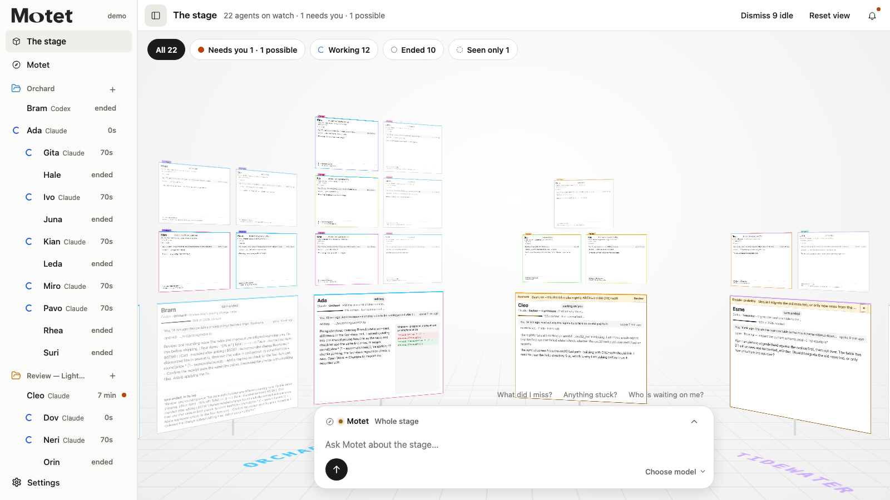
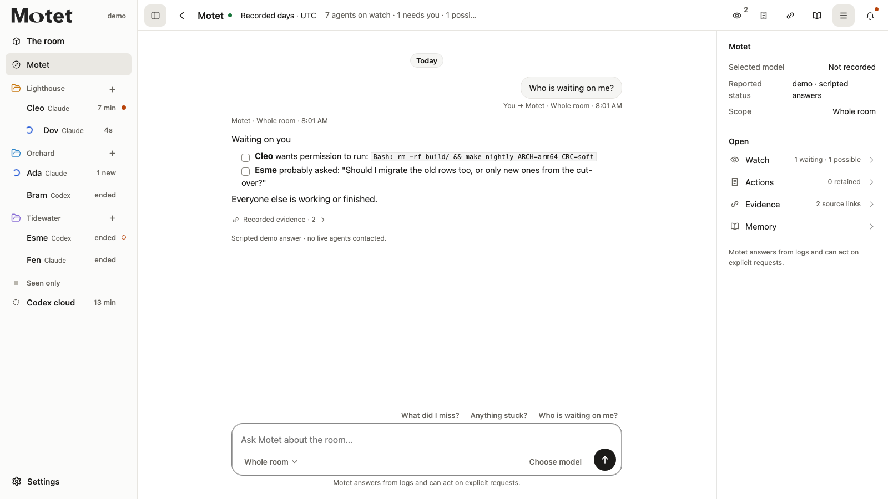
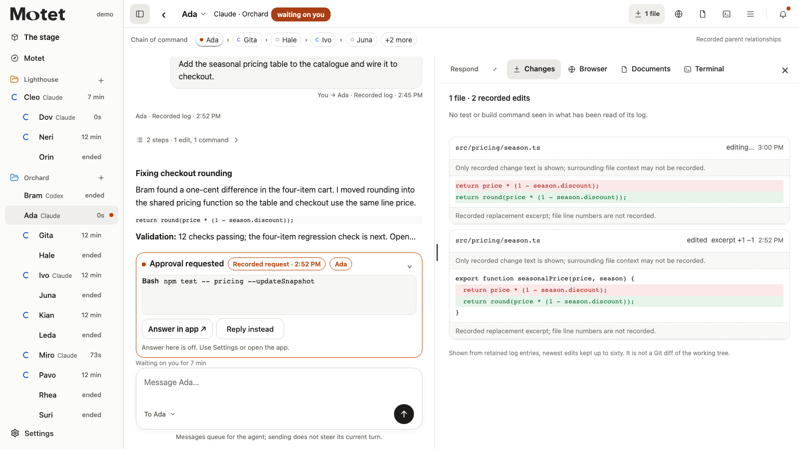

<p align="center">
  <picture>
    <source media="(prefers-color-scheme: dark)" srcset="docs/media/logo-green.svg">
    
  </picture>
</p>

<p align="center">
  <b>Your AI agents, in concert.</b><br>
  An agent that sits above your agents: it listens to them, tells you which one needs you, and cues the right one when you say the word.
</p>

<p align="center">
  <a href="#take-the-podium">Try it</a> &middot; <a href="#meet-motet">Meet Motet</a> &middot; <a href="#the-bridge">The bridge</a> &middot; <a href="#where-motet-is-and-where-it-is-going">Roadmap</a> &middot; <a href="#privacy-and-trust">Privacy</a> &middot; <a href="#guides">Guides</a> &middot; <a href="#license">License</a>
</p>

<p align="center">
  
</p>

You have several agents playing at once: Claude Code on one part, Codex on another, Cursor on a third. Each is good alone, but nobody is keeping them together. You find out an agent stopped to ask a question twenty minutes after it asked.

Motet gives you the podium, and an assistant beside it who has been listening to every player.

*A motet is a piece of music for several independent voices. That's what running agents is.*

**Try the live demo in your browser: <https://usemotet.com/demo>.** Made-up agents, nothing to install.

## Meet Motet

Motet is an agent of its own. It follows what each of your agents records, so you ask one assistant instead of opening six windows.

- **It listens.** Motet follows each agent's log as it is written: what it was asked, what it ran, what it changed, where it stopped.
- **It answers.** *What did I miss? Is anything stuck? Who changed this file?* It answers from the records, links the entries it used, and says what it can't confirm. In Auto mode it picks the model for you: a quick one for everyday questions, a stronger one for summaries and handovers.
- **It cues a desk.** Ask Motet to put a question to an agent. It carries your words to that desk and brings the answer back. On verified versions of the Codex app it can also steer or stop a running turn.

Motet acts only when you ask. It does not yet act by itself; that is the biggest thing it does not do yet. See [where it is going](#where-motet-is-and-where-it-is-going). A question you send this way is queued for the agent and does not interrupt it. Questions and cues through Motet use your own Anthropic API key.

<p align="center"></p>
<p align="center"><sub><b>Motet's desk.</b> Ask about the stage and read the answer with the recorded evidence behind it. In the demo the answers are scripted and say so.</sub></p>

## The bridge

**Claude can ask Codex. Codex can answer.**

Your Claude Code chats and your Codex chats live in separate apps. Motet gives them a way to talk. One agent asks another a question in plain words and the answer comes back to it, so the work carries on without you copying notes from window to window.

- **Across companies.** It works between eligible Claude Code and Codex chats on your Mac today. On Linux a Claude Code chat can receive too (a Codex chat receives only on a Mac); on Windows a Claude Code chat can receive too, as on Linux, checked by automated tests but not yet on a real PC; the Antigravity plugin and inbox stay macOS and Linux only. An Antigravity chat can ask them too, through an optional plugin. Agents from the same company keep using that app's own tools.
- **You stay in charge.** Agents are instructed to contact another only when you have asked for it. The bridge cannot check who is calling, so that is a rule they follow, not a lock. A message from another agent never gives it new permissions.
- **Nothing passes as delivered.** A question that is waiting, failed or answered is shown as what it is. Requests and replies are kept for 24 hours. A reply is filed against the question and collected when the asking agent needs it; it does not wake a chat that has stopped.
- **A finished turn frees the chat.** When Motet sees an agent's turn end, the chat takes new messages again, even if its reply could not be used. When Motet cannot confirm that a message arrived or that its turn ended, the chat is listed in Settings → Connections under **Chats on hold** on the Mac running Motet, with the reason and, where it can, a **Clear** button. A turn that still looks like it is running is not listed.

The bridge is optional. Set it up once in each app; a Claude Code chat also needs the plugin connected and agent messaging switched on. Connected agents can read the shared record, so keep secrets out of it. See [the bridge guide](docs/PEER_BRIDGE.md).

## From the podium

When you want to look for yourself, every agent is in view.

- **See the whole ensemble.** Your recent sessions on this Mac, grouped by project, each one showing what it is doing right now. Sub-agents sit under the agent that handed off to them.
- **Hear the cue.** With the optional hooks installed, when a Claude Code agent stops to ask permission, it is marked, counted and put in the bell, with the exact command it wants to run. A question an agent asks is shown too, and one worked out from its last words is labelled as probable. Codex's own permission prompts are not visible to Motet.
- **Read the score.** Open an agent's desk: the conversation on the left, its work on the right. The edits, the commands, the files and the pages it opened. Long runs of steps fold away until you want them.
- **Bring a player in.** Message an agent from its desk, hand it a PDF or a picture, or start a fresh Codex chat in a project's folder, including a folder you add yourself.
- **Catch the wrong note.** A command that looks like a deploy, a push, a delete or a send is flagged as it happens. You choose the words it listens for.

<p align="center"></p>
<p align="center"><sub><b>A desk.</b> The conversation, with the work it produced beside it. Fictional demo data.</sub></p>

## Bring the subscriptions you already have

Motet is not another model plan, and it does not sit between you and one. Your agents keep running in their own desktop apps, under whatever plan you already use them with. Motet connects to those apps on your Mac.

| | Motet reads it | Motet can cue it |
|---|---|---|
| Claude Code | Yes | With the optional plugin |
| Codex | Yes | Yes, for eligible chats |
| Cursor | Yes, without tool results | Not yet |
| Antigravity | Yes, without tool outcomes | Not yet |

Motet does not ask for your logins to those apps. The one separate cost is Motet's own key: questions you ask Motet, and cues you give through it, use your own Anthropic API key, and Anthropic bills for what they use. Watching, messaging an agent directly, sending files and starting chats do not need it.

## Take the podium

Two minutes, nothing to install. You need Git and Python 3.9 or later, on a Mac or a Windows PC. On Windows use `py` in place of `python3`; [docs/WINDOWS.md](docs/WINDOWS.md) has the steps.

```bash
git clone https://github.com/glo6al/motet.git && cd motet
python3 src/server.py
```

**Start with the demo.** Open <http://127.0.0.1:8793/?demo>. Made-up agents on made-up projects play through a working session: one is waiting for permission, one has a question, one hands off to another. You can click everything. Nothing is sent anywhere.

**Then your own agents.** Open <http://127.0.0.1:8793/> and press **Unlock**. Sessions that were active in the last twenty minutes appear.

Four things are optional, and each adds one ability:

| To do this | Set up this |
|---|---|
| Ask Motet questions, and cue agents through it | Your Anthropic API key saved as `~/.live-room/anthropic-key`, a plain file only you can read. See [How Motet works](docs/HOW_IT_WORKS.md). |
| See and answer Claude Code's permission prompts in Motet | With the server running, `python3 scripts/install_hooks.py`, then switch **Answer prompts here** on in a window. Read [Privacy and trust](#privacy-and-trust) first. |
| Message a Claude Code chat, or send it files | The optional plugin for Claude Code. See [Messaging an existing Claude chat](docs/MESSAGING.md#messaging-an-existing-claude-chat). |
| Let a Claude Code chat and a Codex chat talk to each other | The bridge. See [the bridge guide](docs/PEER_BRIDGE.md). |

Prefer a terminal? With the server running, `python3 src/watch_tty.py` in another terminal shows the same ensemble as a board, with the agents waiting on you first. The longer version of all of this is in [Setting up and running Motet](docs/SETUP.md).

## Where Motet is, and where it is going

We would rather name the gaps than let you find them.

**Works today**

| | Claude Code | Codex | Cursor | Antigravity |
|---|---|---|---|---|
| See what it is doing | Yes | Yes | Yes, without tool results | Yes, without tool outcomes |
| Open the chat in its own app | Yes, in the desktop app | Yes, in the desktop app | Not yet | With an optional connector |
| Send it a message | With the optional plugin | Yes, for eligible chats, on a Mac | Not yet | Not yet |
| Answer its permission prompts | With the optional hooks | Not yet | Not yet | Not yet |
| Send it a PDF or a picture | With the plugin, for eligible chats | On a verified app version, for eligible chats | Not yet | Not yet |
| Start a new chat | No self-serve setup yet | On a verified app version | Not yet | Not yet |
| Steer or stop a running turn | Not yet | On a verified app version | Not yet | Not yet |
| Message another company's agent | With the optional bridge | With the optional bridge | Not yet | Not yet |

A chat has to qualify before Motet will send to it. When something isn't available, the button is off and says why. Steering is verified on one build of the Codex app; New chat and sending files on another. With one installed you get one group. Sending files also needs SQLite 3.45 or newer in the Python that runs Motet. The conditions are in [What works with what](docs/PROVIDER_SUPPORT.md). Use **Add project folder** on the Mac running Motet to choose a folder in the Mac's own folder window; adding one never starts a chat.

- **Chats on hold.** A bridge chat whose turn has ended frees itself, even if its reply could not be used; the request then reads *Finished; reply withheld* or *Finished; reply unavailable*. A chat whose message or turn end Motet could not confirm is listed in Settings → Connections → Chats on hold on the Mac running Motet, with how long it has been on hold, when known, and why. **Clear** lets new messages through; it does not stop the agent, and a late answer to the earlier message is not shown. If Motet saw the hold begin, the bell in Motet shows a notice after five minutes; dismissing it does not clear the chat.
- **Remove a saved project folder.** In Settings → Connections → Project folders, remove a folder you added to Motet. Motet forgets it; the folder itself and its chats are untouched. If a connected app still knows the folder, it stays available.
- **A roomier message box.** On the desktop stage, quick questions sit above the box and one small arrow opens the conversation. At every stage width, the recipient stays at the top, your words have a full-width row of their own, and the model choice, microphone and Send sit underneath at the right. The model choice hides while you dictate.
- **Optional local dictation.** A separate local helper and English model enable the microphone beside Send; typing works without them. See [local dictation](docs/DICTATION.md). The helper must be installed and enabled; page checks used generated audio plus an earlier real-microphone proof, and the native engine is verified only on Apple Silicon macOS.

**Not yet**

- **Motet has no loop.** It acts when you ask and then it waits. It does not follow up by itself.
- **It does not plan your day.** There is no morning brief and no to-do list, the way a chief-of-staff agent would keep one.
- **Motet thinks with one provider.** Its own answers run on Anthropic's models only.
- **Cursor and Antigravity are watch-only.** Motet can see them but cannot message them.
- **No live browser.** You see the pages an agent opened, not the page as it is right now.
- **Mac and Windows, and only coding sessions on this computer.** On Windows, Motet watches and answers, and it can message a Claude chat through the plugin. Allow and Deny and Claude messaging are new there and checked only by automated tests so far, not yet on a real PC. Messaging Codex stays Mac-only for now. The bridge between agents now starts on Windows too, with Claude chats as recipients, as on Linux; it is checked by automated tests, not yet on a real PC. New chat can now start a Claude chat on Windows too, once the PC's owner has written its readiness record; it is checked by automated tests, not yet on a real PC, and New chat for Codex stays Mac-only. Files and dictation are still to come on Windows. Claude messaging, and the bridge with Claude chats as recipients, also work on Linux now, checked by automated tests. Web chats are not brought in.

**Designed, not built yet**

- **Dictation on more devices.** Local desktop dictation is optional; phone capture and broader native-platform support need further work.
- **A live browser at the desk.** A real page you will open and operate yourself beside an agent's conversation, kept apart from the record of the pages its tools fetched.
- **Permission requests at phone width.** The same request cards on a phone-sized screen. Today a request can only be answered on the computer that runs Motet; answering from another device has to be proven safe first.

**Further out**

- **Motet takes the baton.** A loop of its own. Motet would watch for the cue you care about, follow up with an agent, plan the day with you, and keep two agents working on the same piece in step. You would stay the conductor and decide how much it may do.
- **Motet on any provider.** Run Motet itself on the model provider you choose, not only Anthropic.
- **New chat everywhere.** Claude Code and more apps, with files in the first instruction.
- **More players.** Messaging for Cursor and Antigravity where a supported route exists.
- **Older history.** Bring in sessions from before Motet was running. Today its optional memory covers only what it recorded while it ran.
- **Everything on Windows, then Linux.**

A roadmap is a direction, not a promise or a date. The full version, with what has been proven and what is only an idea, is in [docs/ROADMAP.md](docs/ROADMAP.md).

## What Motet won't claim

Motet shows what the records contain and says so when they run out. It would rather tell you less than guess.

- **Started is not finished.** A command with no recorded result is shown as open or returned, never as done.
- **A guess is labelled a guess.** "Probably needs you" means probably. It is worked out from what the agent said, and it can be wrong.
- **Quiet is not idle.** "No log entry for ten minutes" means the log is silent, and nothing more.
- **No invented reasoning.** An agent's private thinking isn't in its log, so Motet never shows or paraphrases it.

The complete list is in [What you can and cannot see](docs/EVIDENCE.md).

## Privacy and trust

Motet reads the session logs your agents already write, and it never changes them. It listens only on your own computer, behind a private key kept in your user folder. No account and no sign-up. Answering Claude Code's permission prompts through the hooks is off until you switch it on, one browser window at a time.

**What leaves your computer**

- **A question you ask Motet** goes to Anthropic with the log excerpts and conversation it needs. A question about a file sends that file instead of the logs.
- **A message, a cue or a new chat** goes to that agent's own app, and from there to its provider, just as if you had typed it there.
- **A file you send to an agent** is copied into that agent's project folder. Its provider can receive it when the agent reads it.
- **With a key set up,** Motet also asks Anthropic for its list of models and, if you add a separate admin key, for your organization's usage figures. No logs are sent for either.
- **With the bridge set up,** chat names, project labels, and the questions and replies agents exchange can reach the other company's model.

The Motet app sends none of this to us. It runs only on your computer, and there is no Motet cloud.

Read the full [trust boundary](docs/TRUST_BOUNDARY.md) before you let Motet answer prompts, send files or start chats.

## Guides

The detail lives in guides, one subject each.

| Guide | What it covers |
|---|---|
| [Setting up and running Motet](docs/SETUP.md) | Starting it, the demo, the optional hooks, moving around, the terminal view, Windows differences |
| [A tour of the stage and the desk](docs/TOUR.md) | The two views, in Workspace and in the earlier Classic interface |
| [What you can and cannot see](docs/EVIDENCE.md) | What Motet shows, how each item was learned, and what the records cannot tell you |
| [What works with what](docs/PROVIDER_SUPPORT.md) | Each app's abilities today, files, New chat, and the conditions a chat has to meet |
| [Motet, the assistant](docs/MOTET.md) | Its instructions, its evidence, what questions cost, and its optional memory |
| [Messaging and controlling agents](docs/MESSAGING.md) | Sending to an agent, asking through Motet, steering Codex, the Claude plugin |
| [The bridge](docs/PEER_BRIDGE.md) | Letting a Claude Code chat and a Codex chat talk to each other |
| [Trust boundary](docs/TRUST_BOUNDARY.md) | What Motet can reach, what leaves the computer, and what is left unproven |
| [How Motet works](docs/HOW_IT_WORKS.md) | Where the stage gets what it shows, and the project layout |
| [Motet agent core](docs/MOTET_AGENT_CORE.md) | The design for Motet's working day between your questions: not built yet |
| [Roadmap](docs/ROADMAP.md) | What is being built, what is designed, what is only an idea, and the known limits |
| [Windows](docs/WINDOWS.md) | Installing and trying it on Windows, and what to report |

## Status

Early, and in daily use by its author. It runs on macOS. On Windows it has been run on one real PC, where watching works; its answers are checked so far only by the automated tests, and it does not act on your agents yet; [docs/WINDOWS.md](docs/WINDOWS.md) explains how to try it and what to report. The earlier interface is still available at `?ui=classic`.

Current version is [v0.1.0](CHANGELOG.md).

## Contributing

Issues and pull requests are welcome. See [CONTRIBUTING.md](CONTRIBUTING.md). Open pull requests against the `dev` branch, not `main`, because changes are checked together on `dev` before a release. Two rules keep the project honest:

- **Label the source.** Recorded is not inferred, running is not finished, failed is not blocked, absent is not zero, and unknown is not success.
- **Review before trust.** Changes that touch the key, permission prompts or previews get an independent review before they are relied on.

If you find a way for a log, a preview or another local program to do something this page or the guides say it cannot, please report it privately through the repository's security advisory page.

## License

Motet is open source under the [Apache License 2.0](LICENSE): free to use at home and at work, and free to change. The Motet name and logo are reserved and are not covered by that license. See [NOTICE](NOTICE) for attribution and [Third-party notices](THIRD_PARTY_NOTICES.md) for bundled third-party terms.

Built by its owner with AI coding agents, and reviewed before each release by a different model from the one that wrote the change.
