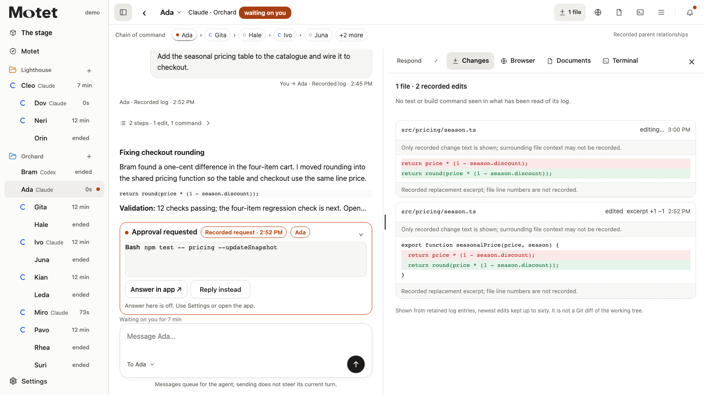
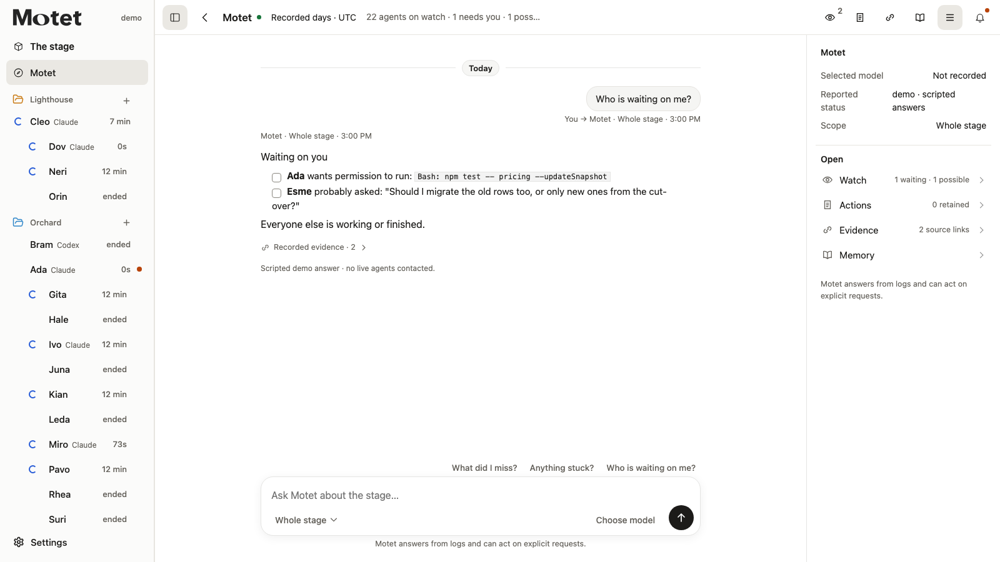
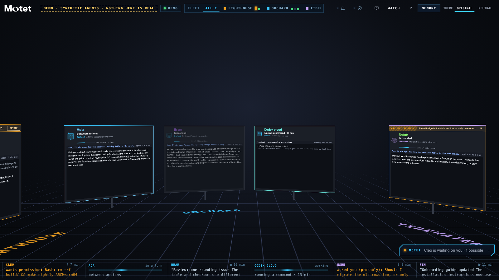
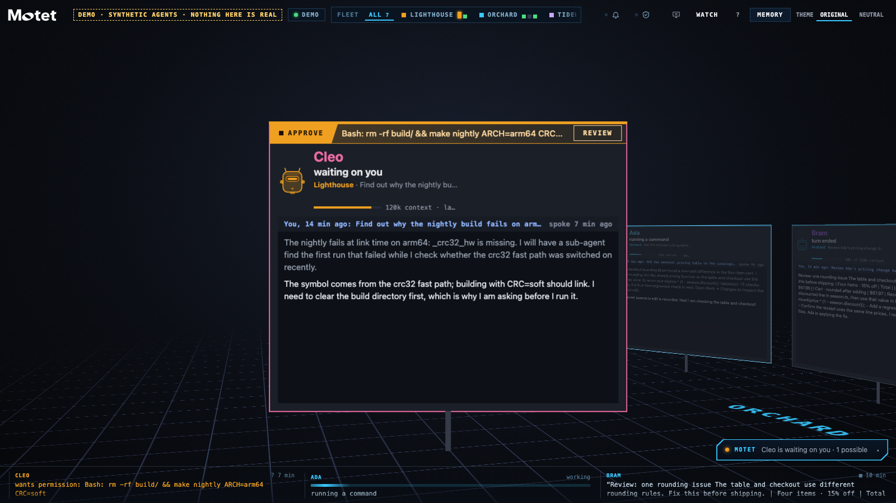
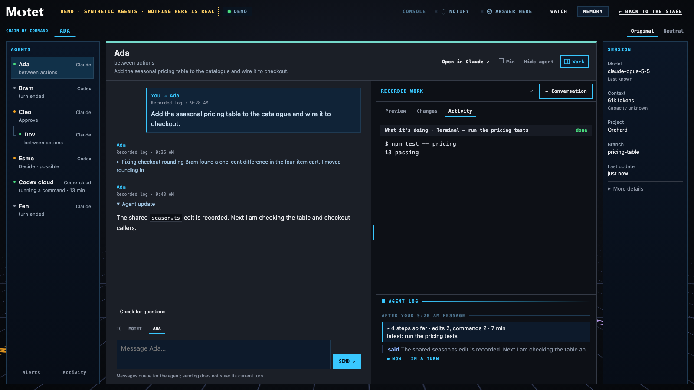
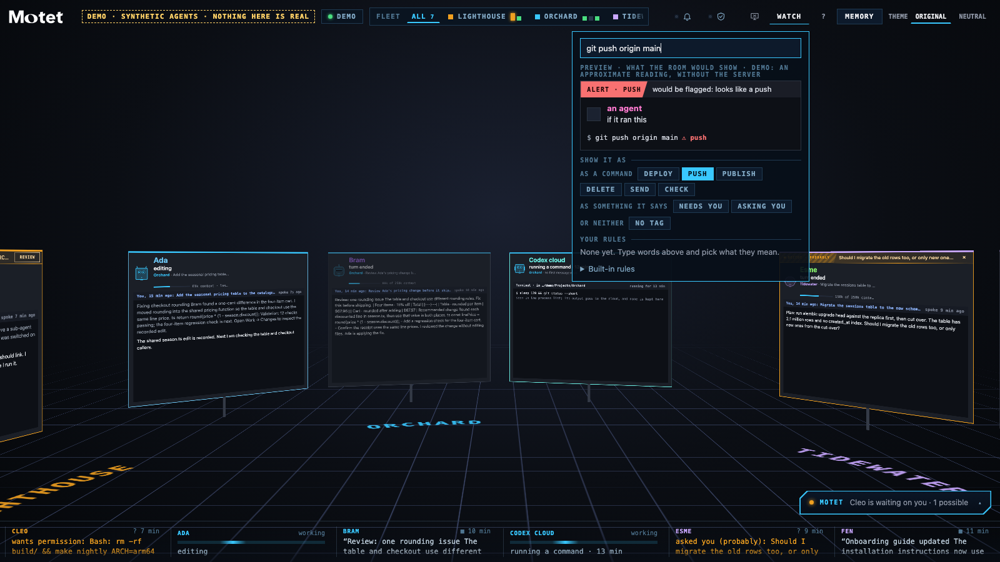
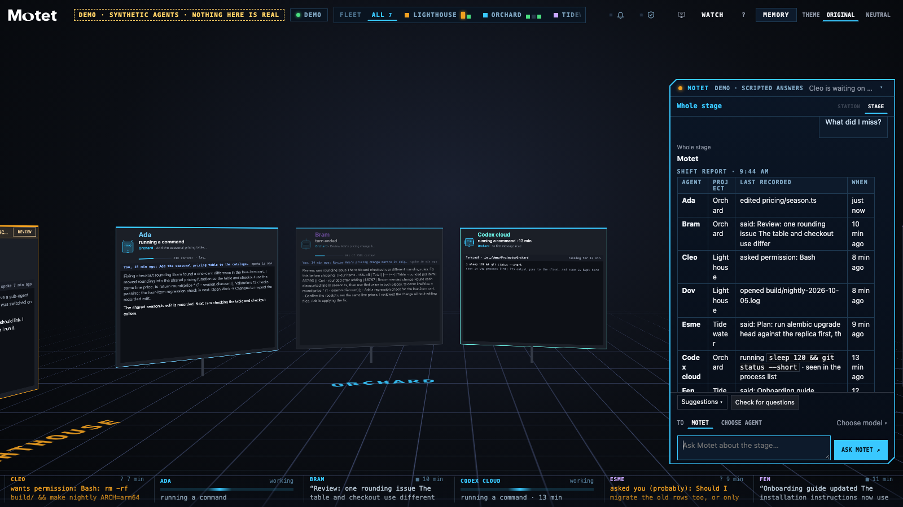
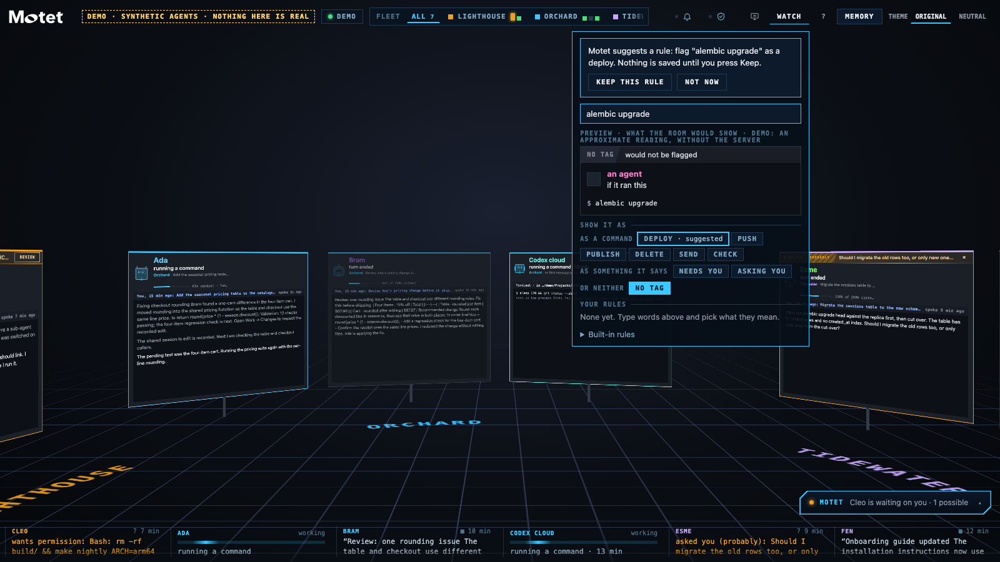

# A tour of the stage and the desk

What the two views are, in Workspace and in the earlier Classic interface. Part of the [Motet README](../README.md).

## Why this exists

Your AI conversations live in separate tools. A discussion in Claude, a coding session in Codex, and a task in Cursor each have their own window, history, and controls. Returning to the right conversation means remembering where it lives, what you asked, and what happened since you last looked.

Motet brings supported sessions into one interface, with their conversations, recorded work, and available actions together. You can move between sessions without losing which provider or project they belong to. When a session has agents working beneath it, their relationships and activity stay visible too. Managing several running agents is one use of that workspace; returning to a conversation and understanding its context is another.

The **stage** gives you an overview of sessions and anything that may need your attention. Step up to a **desk** to read a conversation, inspect its work alongside it, and use the actions supported by that connection. Use **Ask Motet** to understand the recorded context and carry out explicit supported requests.

## Workspace interface

The [plain address](http://127.0.0.1:8793/) opens Workspace on desktop and phone. Use [`?demo`](http://127.0.0.1:8793/?demo) for the Workspace demo. The previous interface is available at [`?ui=classic`](http://127.0.0.1:8793/?ui=classic), with its demo at [`?demo&ui=classic`](http://127.0.0.1:8793/?demo&ui=classic). Unlock keeps the current interface, and the choice lives in the address. Existing `?ui=workspace` links still open Workspace. Workspace opens in the light theme. Theme selections made there are temporary and leave the saved Classic theme preference intact.

Workspace brings the stage sidebar, notification bell, monitor contents, conversation desks and Settings into one light interface. Stage movement and interactions stay the same. The bottom caption strip is omitted; each agent’s sidebar tooltip carries its caption and recorded or inferred qualifications. Opening the notification bell shows existing requests and recorded alerts. The **Notify me** control remains separate in Settings.

<b>An agent's desk in Workspace.</b> The conversation on the left, recorded changes on the right. Fictional demo data.

Choose **Motet** in the sidebar for its desk. **Recorded days · UTC** opens retained Motet questions and answers when memory recording has captured them. Saved days are read-only: browsing them makes no model call and cannot retry, apply or send anything. Coverage can be partial, not recorded, expired or unavailable. Return to the current window to continue your conversation; its draft stays in place.

<b>Motet's desk.</b> Ask about the stage and read the answer with the recorded evidence behind it. In the demo the answers are scripted and say so.

See [brand assets](../brand/README.md) for the Motet wordmark and icon. Workspace follows the same provider and permission limits described in [What works with what](PROVIDER_SUPPORT.md).

The sidebar names the app each agent runs in (Claude, Codex, Antigravity or Cursor) as text after its name. To show icons instead, put your own files in `~/.live-room/app-icons/`, named `claude`, `codex`, `antigravity` or `cursor` with `.svg` or `.png` (up to 256 KB each, a plain file, not a link), then reload the page. Motet ships without provider icons and the demo always shows text; you are responsible for having the rights to any icons you add. Icons are not offered on Windows yet.

## The stage and the desk

These pictures are from the [Classic demo](http://127.0.0.1:8793/?demo&ui=classic), which uses fictional agents and projects. Open it to explore the same examples.

<b>The stage.</b> One monitor per agent, seated by project. The ledge along the bottom says where each idle agent stopped and shows a sweeping rail for each one that is working.

<b>In hand.</b> Hover and the monitor comes to you and stays put while you turn the camera, showing what the agent is saying under your last message to it. The banner across its top is the permission request it is waiting on; click its tag to open it at the desk.

<b>The desk.</b> Read the conversation and inspect recorded work alongside it. Work offers Preview, Changes and Activity; its divider adjusts the space. The agent tree preserves parent–child relationships, while session details stay in the right rail.

<b>Watch.</b> Type a command or a sentence and the panel draws the banner the stage would give it. If that is wrong, click what it should be and the stage learns those words. Your rules are listed below; the built-in ones are folded under them, each with a switch.

<b>Motet.</b> The plate on the bottom band carries the stage's own count of who is waiting on you; press it, or <code>/</code>, and it opens as this panel. Ask about the stage in plain English. The answer comes from the logs the stage keeps, laid out like a README when that reads better, with the entries it consulted as chips that jump to them. Outside the demo, the server asks the model; in the demo the answers are scripted from the synthetic agents and say so.

<b>A rule it drafted.</b> Ask Motet to flag something and it drafts the words and the kind into the Watch panel, with the stage's preview and two plain buttons, Keep this rule and Not now. Nothing is saved until you press Keep this rule; Motet cannot press it, and no answer can write a rule on its own.

